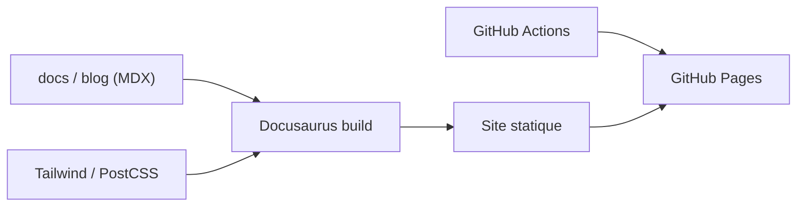

# open-webui/docs

> Sources of the official documentation of Open WebUI, a self-hosted LLM interface, built with Docusaurus.

## The problem
Open WebUI users need up-to-date installation, API, pipeline and RAG guides.

## What it actually does
Docusaurus site with content (`docs`, `blog`), assets, custom components (sponsors, banners), Tailwind/PostCSS styles, TypeScript/ESLint configuration, deployment via GitHub Actions to GitHub Pages. The README announces installation guides, plugins, API and pipelines, file uploads and RAG, a contributor guide.

## How it is wired

## Trying it
No command documented in the README.

## Cost and gotchas
Free. No license declared: reuse of the texts needs clarifying. Very short README.

## What it is not
Not Open WebUI itself: only its documentation.

## Alternatives
None named in the README.

## For you
Worth watching only as an online reference if you deploy Open WebUI; the repository has nothing to install.
