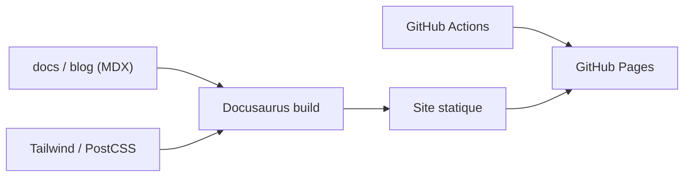

# open-webui/docs

> Sources de la documentation officielle d'Open WebUI, interface auto-hébergée pour LLM, bâtie avec Docusaurus.

## Le problème
Les utilisateurs d'Open WebUI ont besoin de guides d'installation, d'API, de pipelines et de RAG à jour.

## Ce que ça fait vraiment
Site Docusaurus avec contenu (`docs`, `blog`), assets, composants personnalisés (sponsors, bannières), styles Tailwind/PostCSS, configuration TypeScript/ESLint, déploiement via GitHub Actions vers GitHub Pages. Le README annonce guides d'installation, plugins, API et pipelines, envois de fichiers et RAG, guide du contributeur.

## Comment c'est branché

## Essayer
Aucune commande documentée dans le README.

## Coût et pièges
Gratuit. Aucune licence déclarée : réemploi des textes à clarifier. README très court.

## Ce que ce n'est pas
Pas Open WebUI lui-même : seulement sa documentation.

## Alternatives
Aucune nommée dans le README.

## Pour toi
À surveiller seulement comme référence en ligne si tu déploies Open WebUI ; le dépôt n'a rien à installer.

