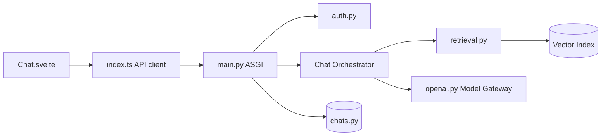

# open-webui/open-webui

> Self-hosted web interface for AI chat, for Ollama and any compatible OpenAI API, with RAG (Retrieval-Augmented Generation).

## The problem
Provide a team with a chat interface on local or cloud-based models, along with access to relevant documents and tools, without requiring them to use a Software-as-a-Service (SaaS) platform.

## What it actually does
A Svelte client (`Chat.svelte`) communicates with an ASGI Python application (`main.py`) that authenticates users (using RBAC, LDAP, OAuth, SCIM), stores conversations (`chats.py`), adds contextual information from documents or the web, calls models and tools, and then returns the response via HTTP or WebSocket.

Local RAG (Retrieval-Augmented Generation) on 9 vector databases (ChromaDB, PGVector, Qdrant…) with hybrid BM25 + vector search and reranking; web search via multiple providers.
Plugins (Filters, Actions, Pipes, Tools), MCP/OpenAPI servers, notes, team channels, calendar, automations, model evaluation arena. SQLite or PostgreSQL; OpenTelemetry.

## How it is wired

## Trying it
There are no commands in the read-only part of the README: it mentions pip, uv, Docker, Kubernetes, and the images `:ollama` / `:cuda`, but without any command-line instructions.

## Cost and gotchas
Free for self-hosting; cloud models and search providers are your responsibility. An enterprise offering is available (sales team).

## What it is not
This is not an inference engine; it requires Ollama, vLLM, or an API to function. The functional scope is very broad (calendar, channels, notes): there is a lot to configure and secure. License not identified by GitHub: needs to be verified.

## Alternatives
None of the alternatives listed in the README (LMStudio, vLLM, and OpenRouter) are mentioned as compatible backends.

## For you
To be used as an internal cat-like façade for your models, with RAG integration.
