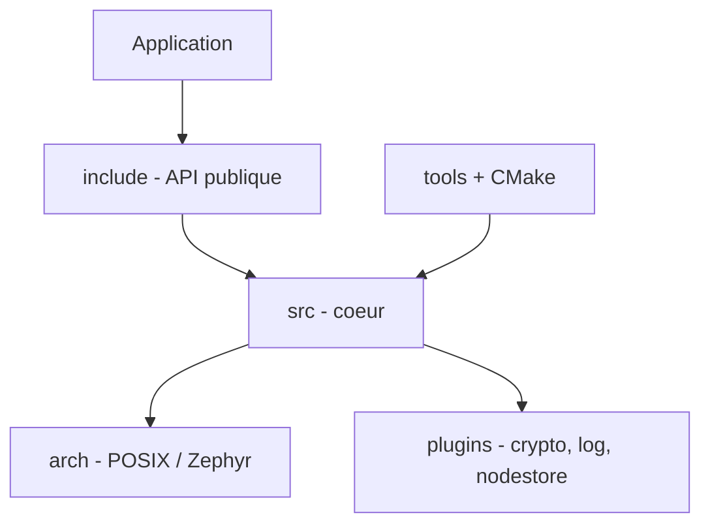

# open62541/open62541

> Open source implementation of OPC UA in C99, for writing industrial servers and clients, including embedded ones.

## The problem
Connecting an application or a PLC to the OPC UA industrial standard forces you to implement a heavy, certifiable protocol stack.

## What it actually does
Provides an OPC UA (IEC 62541) server and client library in C. The core (`/src`) depends only on the C99 libc; everything platform-related goes through plugins (EventLoop, crypto, information model storage). The code is partly generated from the standard's XML files by Python scripts. A v1.4 example server is certified "Standard Server 2017 Profile" by the OPC Foundation.

## How it is wired


## Trying it
```bash
apt install libopen62541-1.4-dev
gcc -std=c99  -lopen62541 -o server
git submodule update --init --recursive
```

## Cost and gotchas
Free. Encryption requires mbedTLS or OpenSSL depending on the configuration; code generation requires Python at build time. 567 open issues.

## What it is not
Not a ready-to-plug product: it is a C SDK, you have to write the server or the client. MPL-2.0: modifications to the library's files must stay under MPL, but separate proprietary code is free.

## Alternatives
No alternative named in the README.

## For you
Ignore for a data/AI/MLOps profile unless you ingest data from industrial PLCs: this is a low-level C protocol stack, not analytics.
