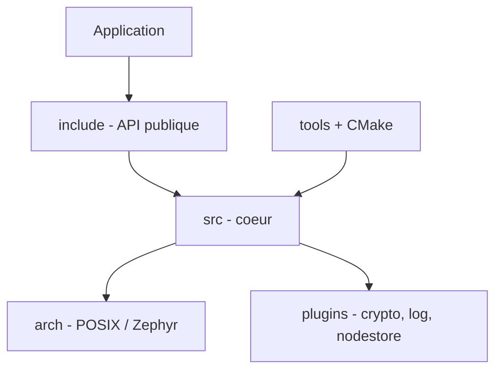

# open62541/open62541

> Implémentation open source d'OPC UA en C99, pour écrire serveurs et clients industriels, y compris embarqués.

## Le problème
Brancher une application ou un automate sur le standard industriel OPC UA oblige à implémenter une pile protocolaire lourde et certifiable.

## Ce que ça fait vraiment
Fournit en C une bibliothèque serveur et client OPC UA (IEC 62541). Le cœur (`/src`) ne dépend que de la libc C99 ; tout ce qui touche la plateforme passe par des plugins (EventLoop, crypto, stockage du modèle d'information). Le code est partiellement généré depuis les XML du standard par des scripts Python. Un serveur exemple v1.4 est certifié « Standard Server 2017 Profile » par l'OPC Foundation.

## Comment c'est branché


## Essayer
```bash
apt install libopen62541-1.4-dev
gcc -std=c99  -lopen62541 -o server
git submodule update --init --recursive
```

## Coût et pièges
Gratuit. Le chiffrement demande mbedTLS ou OpenSSL selon la configuration ; la génération de code requiert Python au build. 567 issues ouvertes.

## Ce que ce n'est pas
Pas un produit prêt à brancher : c'est un SDK C, il faut écrire le serveur ou le client. MPL-2.0 : les modifications des fichiers de la bibliothèque doivent rester sous MPL, mais le code propriétaire séparé est libre.

## Alternatives
Aucune alternative nommée dans le README.

## Pour toi
À ignorer pour un profil data/IA/MLOps sauf si tu ingères des données d'automates industriels : c'est de la pile protocolaire C bas niveau, pas de l'analytique.

