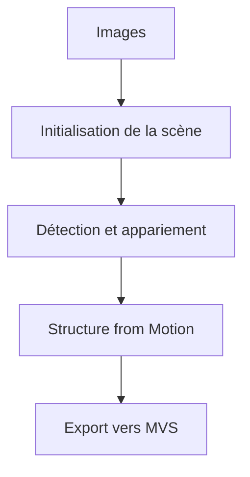

# openMVG/openMVG

> C++ library for 3D reconstruction from images, for reproducible research in photogrammetry.

## The problem
Reconstructing a 3D scene from photos requires manually assembling point detection, matching and structure-from-motion.

## What it actually does
Provides libraries (image handling, descriptors, camera models, multi-view geometry, robust estimation, structure-from-motion), binaries for each task and pipelines that chain them. Can export to other multi-view stereo tools to obtain dense point clouds or textured meshes. Runs on Android, iOS, Linux, macOS and Windows.

## How it is wired
Simplified diagram based on the fiche, no diagram provided.



## Trying it
No command in the README; it points to the wiki and the local or Docker build tutorial.

```bash
# non documenté dans le README : voir le wiki et le tutoriel de build
```

## Cost and gotchas
Free. C++ compilation required. Detailed documentation lives outside the README.

## What it is not
Not a complete chain up to the textured mesh: the dense part goes through other tools. Not designed for use without compiling.

## Alternatives
No alternative named in the README.

## For you
Keep an eye on it: interesting if you do 3D vision or photogrammetry, otherwise irrelevant for a typical data profile.
