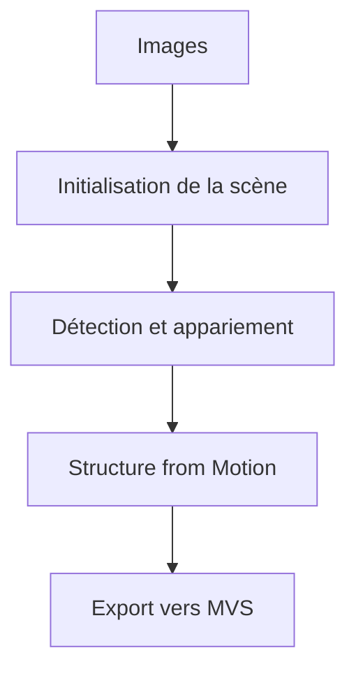

# openMVG/openMVG

> Bibliothèque C++ de reconstruction 3D à partir d'images, pour la recherche reproductible en photogrammétrie.

## Le problème
Reconstruire une scène 3D depuis des photos exige d'assembler à la main détection de points, appariement et structure-from-motion.

## Ce que ça fait vraiment
Fournit des bibliothèques (manipulation d'images, descripteurs, modèles de caméras, géométrie multi-vues, estimation robuste, structure-from-motion), des binaires pour chaque tâche et des pipelines qui les enchaînent. Peut exporter vers d'autres outils de stéréo multi-vues pour obtenir nuages denses ou maillages texturés. Tourne sur Android, iOS, Linux, macOS et Windows.

## Comment c'est branché
Schéma simplifié d'après la fiche, sans diagramme fourni.



## Essayer
Aucune commande dans le README ; il renvoie au wiki et au tutoriel de build local ou Docker.

```bash
# non documenté dans le README : voir le wiki et le tutoriel de build
```

## Coût et pièges
Gratuit. Compilation C++ nécessaire. La documentation détaillée est hors README.

## Ce que ce n'est pas
Pas une chaîne complète jusqu'au maillage texturé : la partie dense passe par d'autres outils. Pas conçu pour un usage sans compilation.

## Alternatives
Aucune alternative nommée dans le README.

## Pour toi
À surveiller : intéressant si tu fais de la vision 3D ou de la photogrammétrie, sinon sans objet pour un profil data classique.

