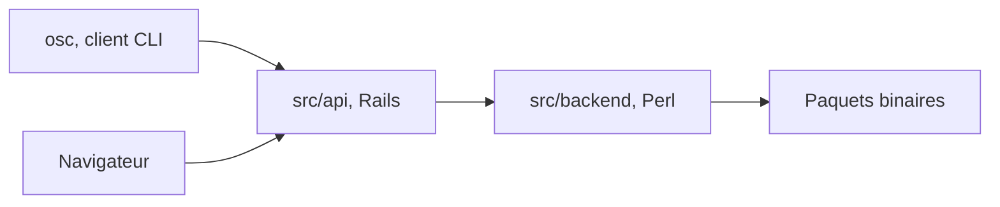

# openSUSE/open-build-service

> Build and distribution system for reproducible binary packages, for Linux distribution maintainers.

## The problem
Building and publishing packages for several distributions and architectures by hand is slow and hard to reproduce.

## What it actually does
Automatically compiles packages from source, consistently and reproducibly, and distributes them. It produces packages, updates, appliances and entire distributions. A backend does the builds, a frontend provides the web application and the XML API. The command-line client, osc, lives in another repository.

## How it is wired
Simplified diagram based on the sheet, no diagram provided.



## Trying it
```bash
zypper ar -f https://download.opensuse.org/repositories/OBS:/Server:/2.10/16.0/OBS:Server:2.10.repo
zypper in -t pattern OBS_Server
/usr/lib/obs/server/setup-appliance.sh --force
```

## Cost and gotchas
Free, but plan for an openSUSE or SLES server. The docker compose is for development only, not production.

## What it is not
Not a generic CI tool nor a data tool. It targets distribution packaging, with a rather heavy deployment (appliance or packages).

## Alternatives
No alternative named in the README.

## For you
Worth watching only if you package software for Linux; for a data, AI or MLOps profile, it brings nothing day to day.
