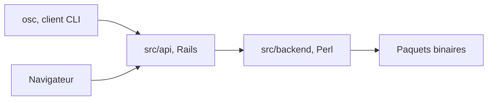

# openSUSE/open-build-service

> Système de build et de distribution de paquets binaires reproductibles, pour mainteneurs de distributions Linux.

## Le problème
Construire et publier des paquets pour plusieurs distributions et architectures à la main est lent et difficile à reproduire.

## Ce que ça fait vraiment
Compile automatiquement des paquets depuis les sources, de façon cohérente et reproductible, et les distribue. Il produit paquets, mises à jour, appliances et distributions entières. Un backend fait les builds, un frontend fournit l'application web et l'API XML. Le client en ligne de commande, osc, vit dans un autre dépôt.

## Comment c'est branché
Schéma simplifié d'après la fiche, sans diagramme fourni.



## Essayer
```bash
zypper ar -f https://download.opensuse.org/repositories/OBS:/Server:/2.10/16.0/OBS:Server:2.10.repo
zypper in -t pattern OBS_Server
/usr/lib/obs/server/setup-appliance.sh --force
```

## Coût et pièges
Gratuit, mais prévoir un serveur openSUSE ou SLES. Le docker compose est réservé au développement, pas à la production.

## Ce que ce n'est pas
Pas un outil de CI générique ni un outil data. Il vise le packaging d'une distribution, avec un déploiement plutôt lourd (appliance ou paquets).

## Alternatives
Aucune alternative nommée dans le README.

## Pour toi
À surveiller seulement si tu empaquettes des logiciels pour Linux ; pour un profil data, IA ou MLOps, il n'apporte rien au quotidien.

