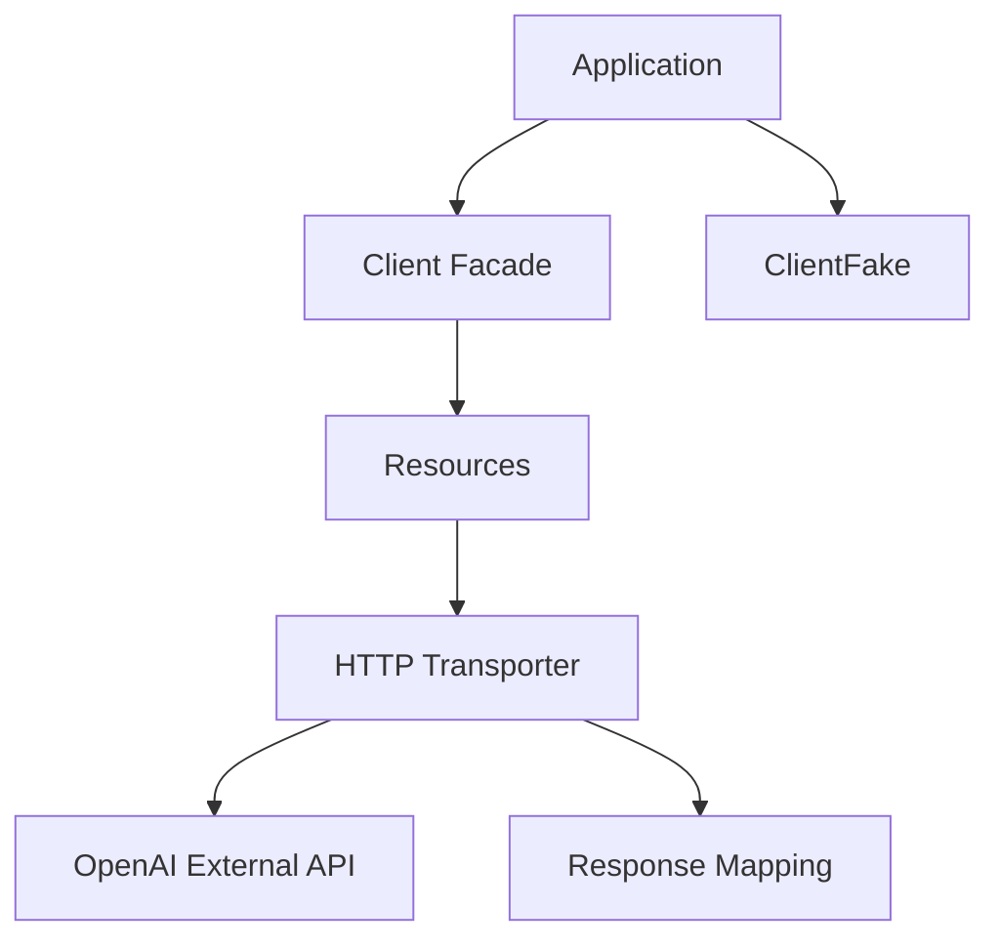

# openai-php/client

> Community PHP client for calling the OpenAI API from a PHP 8.2+ application.

## The problem
Calling the OpenAI API by hand in PHP means handling HTTP requests, streaming flows and response mapping.

## What it actually does
An `OpenAI::client()` facade and a factory expose resources: models, responses, conversations, containers, skills, agents (beta). Resources delegate to an HTTP transporter (a discovered or supplied PSR-18 client, such as Guzzle), and responses are converted into objects. A `ClientFake` is provided for tests.

## How it is wired


## Trying it
```bash
composer require openai-php/client
composer require guzzlehttp/guzzle
```

## Cost and gotchas
OpenAI API key required, billing at your expense. Requires PHP 8.2+ and a PSR-18 HTTP client.

## What it is not
Not a model nor an agent framework: a simple client. Unofficial, maintained by the community.

## Alternatives
No alternative named in the README.

## For you
Ignore unless your application is in PHP: for Python you use the standard SDK.
