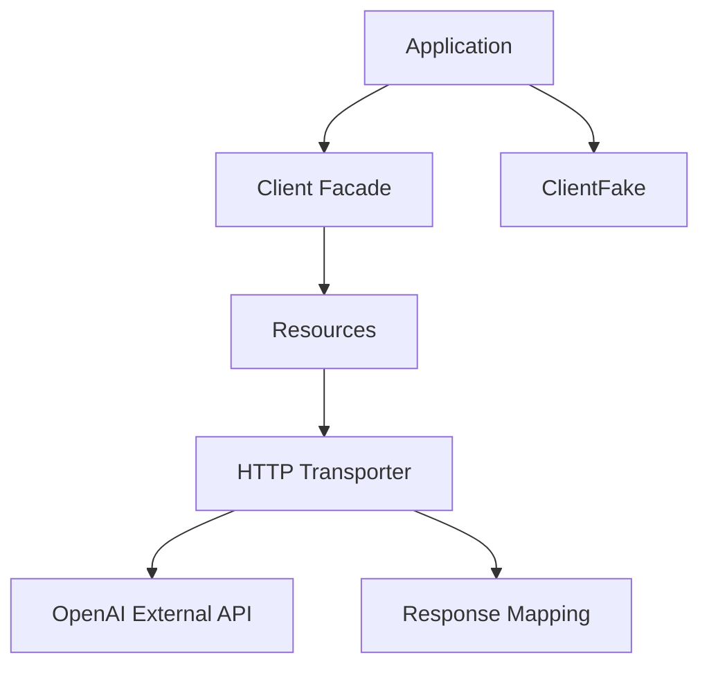

# openai-php/client

> Client PHP communautaire pour appeler l'API OpenAI depuis une application PHP 8.2+.

## Le problème
Appeler l'API OpenAI en PHP à la main oblige à gérer requêtes HTTP, flux en streaming et mapping des réponses.

## Ce que ça fait vraiment
Une façade `OpenAI::client()` et une fabrique exposent des ressources : modèles, réponses, conversations, conteneurs, skills, agents (bêta). Les ressources délèguent à un transporteur HTTP (client PSR-18 découvert ou fourni, comme Guzzle), les réponses sont converties en objets. Un `ClientFake` sert aux tests.

## Comment c'est branché


## Essayer
```bash
composer require openai-php/client
composer require guzzlehttp/guzzle
```

## Coût et pièges
Clé d'API OpenAI obligatoire, facturation à ta charge. Exige PHP 8.2+ et un client HTTP PSR-18.

## Ce que ce n'est pas
Pas un modèle ni un framework d'agents : un simple client. Non officiel, maintenu par la communauté.

## Alternatives
Aucune alternative nommée dans le README.

## Pour toi
À ignorer sauf si ton application est en PHP : pour du Python tu utilises le SDK standard.

