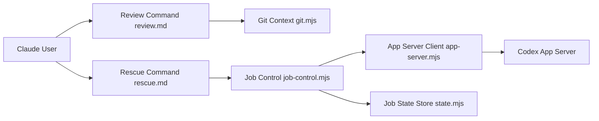

# openai/codex-plugin-cc

> Claude Code plugin to delegate code reviews and tasks to OpenAI's Codex.

## The problem
Getting a second opinion from another coding agent means switching tools and losing context.

## What it actually does
Commands `/codex:review` (read-only), `/codex:adversarial-review` (review steerable toward a given risk), `/codex:rescue` (delegating a fix), `/codex:transfer` (resuming a session in Codex).
Background job management: `/codex:status`, `/codex:result`, `/codex:cancel`.
Goes through the local `codex` binary and its app server, with the same config and authentication.
Optional "review gate" through a `Stop` hook.

## How it is wired


## Trying it
```bash
/plugin marketplace add openai/codex-plugin-cc
/plugin install codex@openai-codex
/reload-plugins
/codex:setup
npm install -g @openai/codex
/codex:review --background
```

## Cost and gotchas
ChatGPT subscription (free tier included) or OpenAI API key; it consumes your Codex quotas. The review gate can loop and drain the quotas.

## What it is not
Not a separate Codex runtime: it depends on the local CLI. `/codex:review` fixes nothing and accepts no instruction.

## Alternatives
No alternative named in the README.

## For you
Handy for cross-checking reviews between two models if you already have a ChatGPT account.
