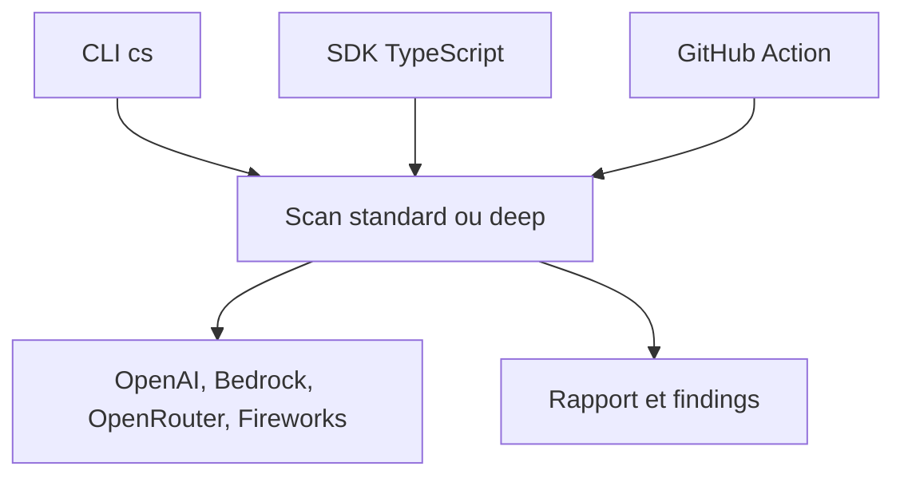

# openai/codex-security

> AI-driven security scanner that finds, validates and fixes vulnerabilities in your code.

## The problem
Auditing a repository for flaws is slow, and scanner results are noisy.

## What it actually does
A `cs` CLI, a TypeScript SDK and a GitHub Action scan a repository, paths or a diff. Findings are validated, deduplicated, with patches and fix verification. Can write a `SECURITY.md`, export a threat model, SARIF, JSON, CSV, and track in Linear, Jira or GitHub.

## How it is wired


## Trying it
```bash
npm install --global @openai/codex-security
cs login
cs scan .
cs scan . --diff origin/main
cs scan . --mode deep
cs policy .
```

## Cost and gotchas
Model calls are at your expense (Action example: estimated limit of $5 per scan, overrun possible). Node 22.13+ or 24/26 and Python 3.10+. Some requests require "Trusted Access for Cyber" access.

## What it is not
Not an offline scanner: it calls a model. The local `serve` dashboard has been removed. The Cloud is optional.

## Alternatives
None named in the README.

## For you
Watch: useful for auditing your MLOps repositories in CI, provided you accept sending code to a model provider and paying for its usage.
