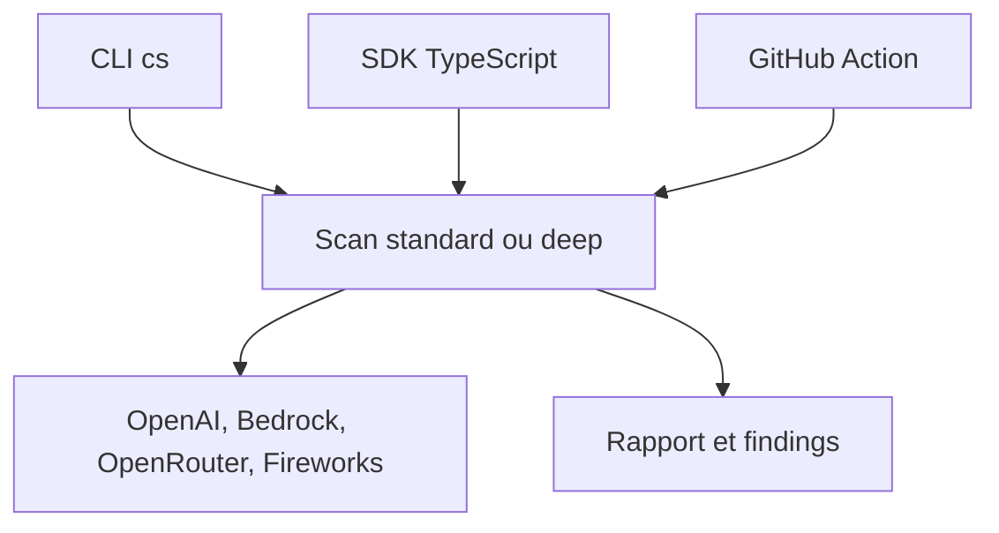

# openai/codex-security

> Scanner de sécurité piloté par IA qui trouve, valide et corrige des vulnérabilités dans ton code.

## Le problème
Auditer un dépôt à la recherche de failles est long, et les résultats des scanners sont bruités.

## Ce que ça fait vraiment
Un CLI `cs`, un SDK TypeScript et une GitHub Action scannent un dépôt, des chemins ou un diff. Les trouvailles sont validées, dédupliquées, avec patchs et vérification de correctifs. Peut rédiger un `SECURITY.md`, exporter un modèle de menaces, SARIF, JSON, CSV, et suivre dans Linear, Jira ou GitHub.

## Comment c'est branché


## Essayer
```bash
npm install --global @openai/codex-security
cs login
cs scan .
cs scan . --diff origin/main
cs scan . --mode deep
cs policy .
```

## Coût et pièges
Appels de modèles à ta charge (exemple de l'Action : limite estimée à 5 $ par scan, dépassement possible). Node 22.13+ ou 24/26 et Python 3.10+. Certaines requêtes demandent un accès « Trusted Access for Cyber ».

## Ce que ce n'est pas
Pas un scanner hors ligne : il appelle un modèle. Le tableau de bord local `serve` a été retiré. Le Cloud est optionnel.

## Alternatives
Aucune nommée dans le README.

## Pour toi
Surveiller : utile pour auditer tes dépôts MLOps en CI, à condition d'accepter envoyer le code à un fournisseur de modèle et d'en payer l'usage.

