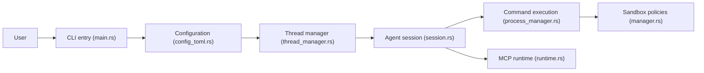

# openai/codex

> OpenAI code agent that runs in the terminal, on the local workspace.

## The problem
Delegating coding tasks to a model requires a local agent loop with tools, a sandbox, and authentication.

## What it actually does
The README is very short: it describes the installation (using curl/PowerShell, npm, Homebrew, or GitHub binaries), connecting with a ChatGPT account or API key, and refers to the documentation. According to the code, the command-line interface (CLI) is written in Rust: it manages an agent thread, executes commands under sandbox policies, includes a MCP client/server, plugins, and remote control. Nothing else is documented in the README.

## How it is wired


## Trying it
```bash
curl -fsSL https://chatgpt.com/codex/install.sh | sh
npm install -g @openai/codex
brew install --cask codex
codex
```

## Cost and gotchas
Free to install; usage requires a ChatGPT subscription (Plus, Pro, Business, Edu, Enterprise) or an API key with "additional configuration". The curl script executes remote code: read it first. Over 24,000 open issues.

## What it is not
Unlike the cloud agent (Codex Web), the editor extension, or the desktop app: the README distinguishes it. It does not document the sandbox or MCP; this information comes from the architecture.

## Alternatives
- Codex Web (chatgpt.com/codex): OpenAI's cloud-based agent.
- IDE extensions (VS Code, Cursor, Windsurf): if you want an editor.

## For you
This is recommended if you already have a ChatGPT plan: official code agent, Apache-2.0, with MCP; maturity depends on the editor, not the README.
