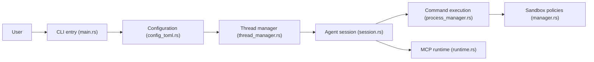

# openai/codex

> Agent de code d'OpenAI qui s'exécute dans le terminal, sur l'espace de travail local.

## Le problème
Déléguer des tâches de code à un modèle exige une boucle d'agent locale avec outils, sandbox et authentification.

## Ce que ça fait vraiment
Le README est très court : il décrit l'installation (script curl/PowerShell, npm, Homebrew, binaires GitHub), la connexion par compte ChatGPT ou clé d'API, et renvoie à la documentation. D'après le code, la CLI est en Rust : gestion d'un thread d'agent, exécution de commandes sous politiques de sandbox, MCP client/serveur, plugins et contrôle à distance. Rien de plus n'est documenté dans le README.

## Comment c'est branché


## Essayer
```bash
curl -fsSL https://chatgpt.com/codex/install.sh | sh
npm install -g @openai/codex
brew install --cask codex
codex
```

## Coût et pièges
Gratuit à installer ; l'usage passe par un abonnement ChatGPT (Plus, Pro, Business, Edu, Enterprise) ou une clé d'API avec « configuration supplémentaire ». Le script curl exécute du code distant : lis-le d'abord. Plus de 24 000 issues ouvertes.

## Ce que ce n'est pas
Pas l'agent cloud (Codex Web) ni l'extension d'éditeur ni l'app de bureau : le README les distingue. Il ne documente ni sandbox ni MCP : ces points viennent de l'architecture.

## Alternatives
- Codex Web (chatgpt.com/codex) : agent cloud d'OpenAI.
- Extension IDE (VS Code, Cursor, Windsurf) : si tu veux l'éditeur.

## Pour toi
À adopter si tu as déjà un plan ChatGPT : agent de code officiel, Apache-2.0, avec MCP ; la maturité tient à l'éditeur, pas au README.

