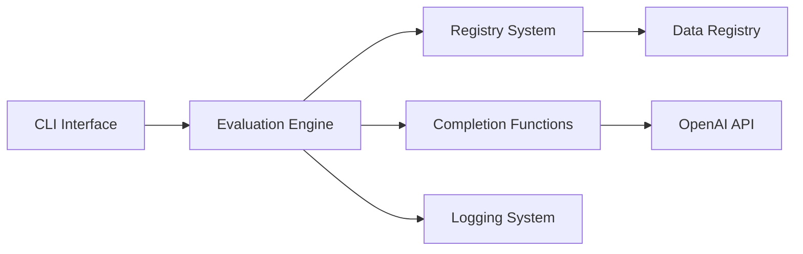

# openai/evals

> Framework and registry of evaluations for measuring LLMs or systems built on them.

## The problem
Without evaluations, it is impossible to know whether a model or prompt change improves or degrades your use case.

## What it actually does
Registry of evals (JSON data + YAML parameters) stored in Git-LFS; basic and model-graded eval templates, no code required.
"Completion functions" protocol for evaluating prompt chains or tool-using agents; per-provider solvers (OpenAI, Anthropic, Google, Together).
Optional logging to Snowflake.
The README notes that evals can also be configured in the OpenAI dashboard.

## How it is wired


## Trying it
```bash
pip install evals
git lfs fetch --all
git lfs pull
pip install -e .
```

## Cost and gotchas
Each eval calls the API and is billed to your OpenAI key. Git-LFS is mandatory for the registry data.

## What it is not
Not a neutral tool: it is centered on OpenAI models and contributions serve OpenAI. Evals with custom code are no longer accepted. License not identified by GitHub, although the text mentions MIT.

## Alternatives
- OpenAI Dashboard: configure and run evals directly online.
- Weights & Biases: cited as another way to run and create evals.

## For you
Worth watching: the eval patterns (model-graded, YAML) are a good reference, but the tool itself is aging and remains tied to the OpenAI ecosystem.
