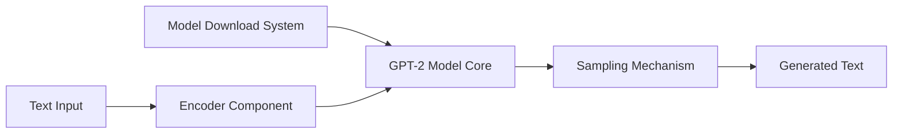

# openai/gpt-2

> Historical code and models from the GPT-2 paper, archived, for research experimentation.

## The problem
Studying a 2019 generative LLM requires the original inference code and weights.

## What it actually does
Provides the model definition (`src/model.py`), the BPE encoder and sampling.
Scripts for conditional and unconditional generation; weights downloaded with `download_model.py`.
CPU and GPU Dockerfiles.
No training code; a set of outputs is published for research.

## How it is wired

## Trying it
No command documented in the README (it refers to DEVELOPERS.md).

## Cost and gotchas
Free; period-specific TensorFlow 1.x. Models are biased and inaccurate according to OpenAI.

## What it is not
Archived, no updates. Not a model usable in production.

## Alternatives
No alternative named in the README.

## For you
Ignore: purely historical value; nanoGPT or Transformers are more practical for working with GPT-2.
