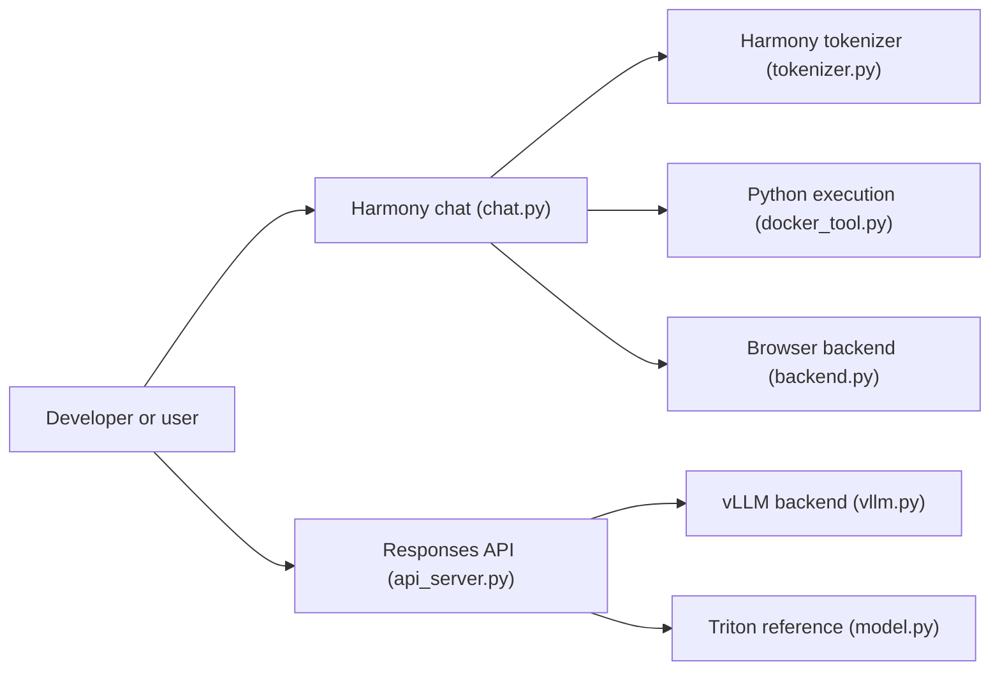

# openai/gpt-oss

> Reference implementations and tools for OpenAI's open models gpt-oss-20b and gpt-oss-120b.

## The problem
Using an open reasoning model requires knowing its conversation format, its training tools and an inference stack that fits in memory.

## What it actually does
Two MoE models under Apache 2.0: 120b (5.1 B active, one 80 GB GPU) and 20b (3.6 B active, 16 GB), quantized in MXFP4.
Mandatory "harmony" format; adjustable reasoning effort, accessible chain of thought.
The repo provides PyTorch (educational, 4×H100), Triton (one GPU) and Metal references, a terminal chat and a Responses API server.
Reference browser and python tools; compatible with Transformers, vLLM, Ollama, LM Studio.

## How it is wired


## Trying it
```bash
pip install gpt-oss
ollama pull gpt-oss:20b
ollama run gpt-oss:20b
hf download openai/gpt-oss-20b --include "original/*" --local-dir gpt-oss-20b/
vllm serve openai/gpt-oss-20b
```

## Cost and gotchas
Free weights, hardware at your expense. The browser tool requires a You.com or Exa key. The python tool runs in a permissive Docker container.

## What it is not
The repo's implementations are not meant for production: use vLLM, Ollama or Transformers. Without the harmony format, the model answers poorly.

## Alternatives
- vLLM: OpenAI-compatible server for production.
- Ollama: for consumer hardware.
- LM Studio: local interface.

## For you
Adopt: an open reasoning model, Apache 2.0, that fits in 16 GB in its 20b version, is a solid local option for your agents and pipelines.
