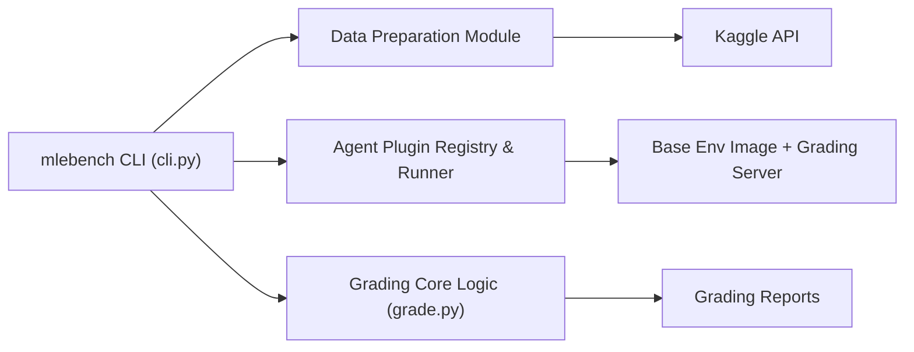

# openai/mle-bench

> Benchmark of 75 Kaggle competitions for evaluating ML engineering agents.

## The problem
There is no common measure of an agent's ability to do real, end-to-end ML engineering tasks.

## What it actually does
Provides data preparation (train/test split of the Kaggle datasets), the grading logic, a base Docker image with a validation server, three evaluated agents (AIDE, OpenHands, MLAgentBench) and the leaderboard. A "Lite" subset of 22 competitions. Extras: a detector for rule violations and plagiarism. The leaderboard has been closed to new submissions since April 2026.

## How it is wired


## Trying it
```bash
git lfs fetch --all
git lfs pull
pip install -e .
mlebench prepare --lite
mlebench grade-sample <PATH_TO_SUBMISSION> spaceship-titanic
docker build --platform=linux/amd64 -t mlebench-env -f environment/Dockerfile .
```

## Cost and gotchas
Kaggle credentials (`kaggle.json`) and accepted competition rules. Full preparation: about two days and 3.3 TB; Lite: 158 GB. Reference config: 36 vCPUs, 440 GB of RAM, a 24 GB A10 GPU, 24 h per run.

## What it is not
Not a clean test: known problems (label leaks, checksums) are listed, and several leaderboard submissions are not comparable (feedback from the test set).

## Alternatives
- openai/frontier-evals: will host v2 with fixes.

## For you
Worth watching: a useful reference for comparing ML agents, but the compute cost is very high and v2 will fix known flaws.
