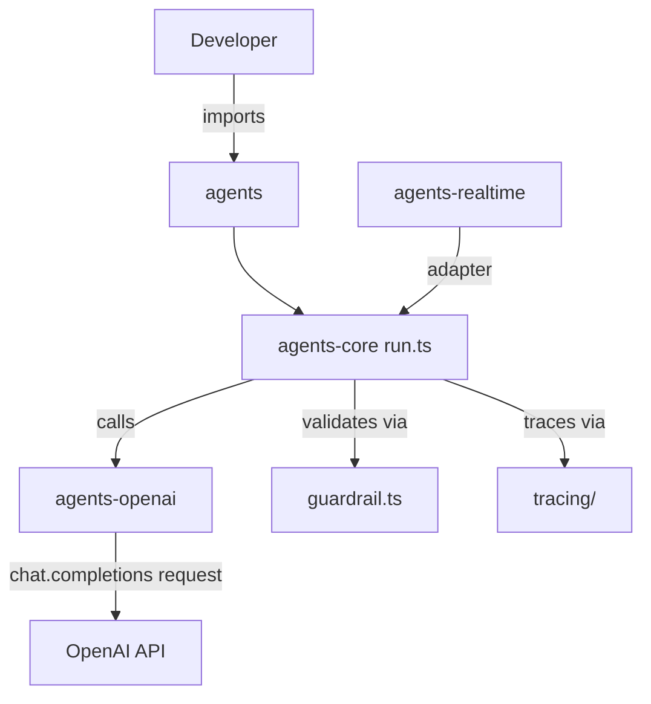

# openai/openai-agents-js

> JavaScript/TypeScript SDK for building multi-agent workflows, with tools, guardrails and tracing, for developers.

## The problem
Orchestrating several LLM agents, their tools, their handoffs and their history takes a lot of homemade plumbing.

## What it actually does
Provides an agent loop with tools (functions, MCP, hosted tools), handoffs between agents, input and output guardrails, history sessions, human approval and tracing. Adds Sandbox agents (a file workspace for long tasks) and Realtime agents for voice over WebRTC. Monorepo with a core package, an OpenAI provider, realtime and extensions.

## How it is wired


## Trying it
```bash
npm install @openai/agents zod
```
Then, in JS: `import { Agent, run } from '@openai/agents'`, create a `new Agent({ name, instructions })` and call `await run(agent, 'prompt')`. Set `OPENAI_API_KEY` on the server side.

## Cost and gotchas
OpenAI API key billed by usage. The local Sandbox agent only runs on macOS and Linux; on Windows you need Docker or a hosted client. In the browser, you need an ephemeral token created by your server.

## What it is not
Not a model nor a service: the SDK calls paid APIs. The README says it is compatible with other providers, but the examples are centered on OpenAI.

## Alternatives
No alternative named in the README.

## For you
Worth watching: useful if your agent stack is in TypeScript and already on OpenAI, of no interest if you work in Python.
