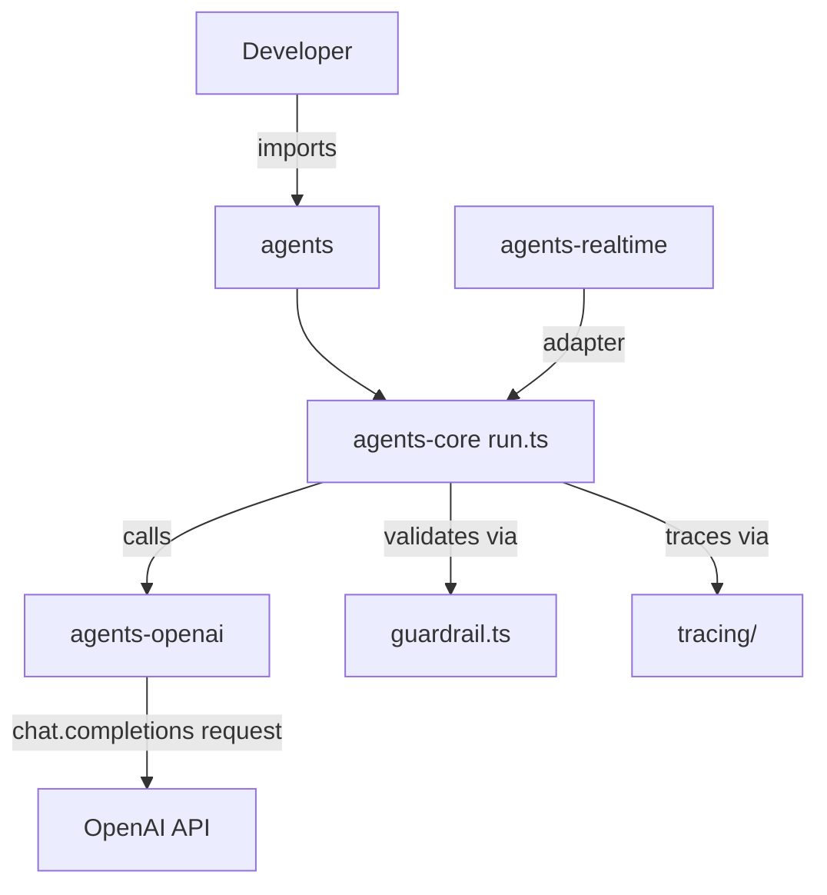

# openai/openai-agents-js

> SDK JavaScript/TypeScript pour construire des workflows multi-agents, avec outils, garde-fous et traçage, pour développeurs.

## Le problème
Orchestrer plusieurs agents LLM, leurs outils, leurs transferts et leur historique demande beaucoup de plomberie maison.

## Ce que ça fait vraiment
Fournit une boucle d'agent avec outils (fonctions, MCP, outils hébergés), handoffs entre agents, garde-fous d'entrée et sortie, sessions d'historique, validation humaine et traçage. Ajoute des agents Sandbox (espace de fichiers pour tâches longues) et des agents Realtime pour la voix en WebRTC. Monorepo avec un paquet cœur, un fournisseur OpenAI, le temps réel et des extensions.

## Comment c'est branché


## Essayer
```bash
npm install @openai/agents zod
```
Puis, en JS : `import { Agent, run } from '@openai/agents'`, créer un `new Agent({ name, instructions })` et appeler `await run(agent, 'prompt')`. Définir `OPENAI_API_KEY` côté serveur.

## Coût et pièges
Clé d'API OpenAI facturée à l'usage. L'agent Sandbox local ne tourne que sur macOS et Linux ; sous Windows il faut Docker ou un client hébergé. En navigateur, il faut un jeton éphémère créé par ton serveur.

## Ce que ce n'est pas
Pas un modèle ni un service : le SDK appelle des API payantes. Le README le dit compatible avec d'autres fournisseurs, mais les exemples sont centrés sur OpenAI.

## Alternatives
Aucune alternative nommée dans le README.

## Pour toi
À surveiller : utile si ton stack agent est en TypeScript et déjà sur OpenAI, sans intérêt si tu travailles en Python.

