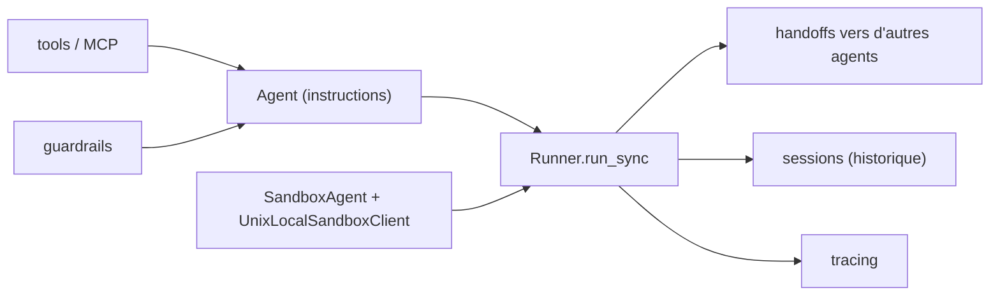

# openai/openai-agents-python

> Python SDK for composing tool-using, voice or sandboxed agents.

## The problem
Hand-writing the model-call / tool-call / handoff loop is redone in every project.
Conversation history, input/output validation and traces are all plumbing to recode.

## What it actually does
An `Agent` is an LLM with instructions, tools, guardrails and handoffs to other agents.
`SandboxAgent` works in a container to inspect files, run commands, apply patches.
`RealtimeAgent` opens a voice/multimodal WebSocket session; `VoicePipeline` chains STT → agent → TTS.
Sessions (automatic history), human-in-the-loop and built-in tracing; compatible with Responses, Chat Completions and 100+ LLMs.

## How it is wired


## Trying it
```bash
python -m venv .venv
source .venv/bin/activate
pip install openai-agents
pip install 'openai-agents[voice]'
uv add openai-agents
```

## Cost and gotchas
`OPENAI_API_KEY` is required before any example: each run consumes billed tokens.
The Unix sandbox only works on macOS/Linux; on Windows you need Docker via the `[docker]` extra.

## What it is not
It is not tied to a single provider — but the default path, the key and the examples are OpenAI.
It is not a platform: no UI, no storage, no deployment provided.
Voice requires the `voice` extra, Redis sessions require another.

## Alternatives
Agents SDK JS/TS: the same library for a JavaScript/TypeScript project.

## For you
The most direct agent SDK if your stack is already OpenAI; look at `SandboxAgent` for long-running tasks.
