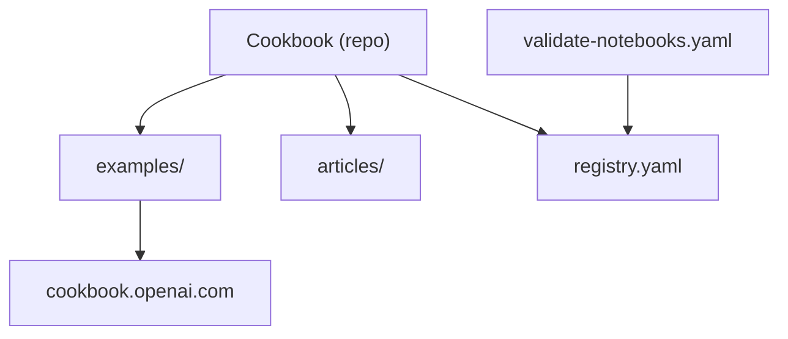

# openai/openai-cookbook

> Examples of code and guides, particularly Python notebooks, for performing common tasks using the OpenAI API.

## The problem
Learn how to use the OpenAI API for embeddings, RAG, agents, or evaluations without having to start from scratch with the raw documentation.

## What it actually does
The README is very short. According to the architecture: `examples/` contains notebooks and mini-projects (embeddings, fine-tuning, agents, RAG, voice, multimodal, evaluations, vector databases, partners), `articles/` contains guides, and `examples/data/` contains test datasets. A `registry.yaml` and workflows validate and publish the cookbook website, cookbook.openai.com.

## How it is wired


## Trying it
```bash
export OPENAI_API_KEY=<ta_cle>
```
The only documented configuration: the `OPENAI_API_KEY` variable (or a `.env` file).

## Cost and gotchas
OpenAI API key and account required; each notebook consumes paid API calls. Each example manages its own dependencies (vector databases, cloud services).

## What it is not
This is not a library or SDK. The examples are isolated and are not guaranteed to be up-to-date with the API.

## Alternatives
No alternative is specified in the README file.

## For you
To be used as concrete examples (evals, agents, RAG) for the OpenAI API, while accepting the vendor lock-in.
