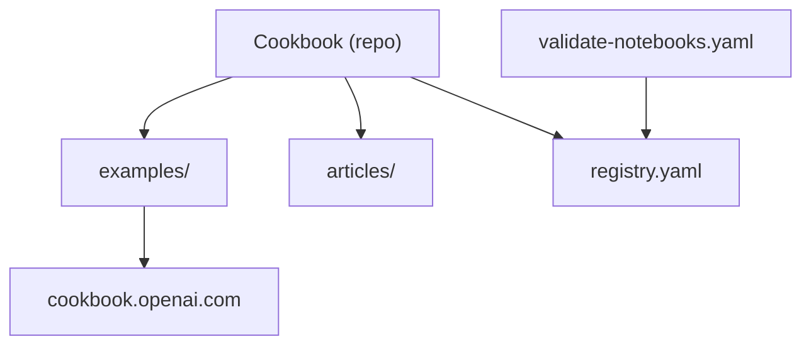

# openai/openai-cookbook

> Exemples de code et guides, surtout des notebooks Python, pour réaliser des tâches courantes avec l'API OpenAI.

## Le problème
Savoir comment utiliser l'API OpenAI pour embeddings, RAG, agents ou évaluations sans repartir de la documentation brute.

## Ce que ça fait vraiment
Le README est très court. D'après l'architecture : `examples/` contient notebooks et mini-projets (embeddings, fine-tuning, agents, RAG, voix, multimodal, évaluations, bases vectorielles, partenaires), `articles/` les guides, `examples/data/` les jeux de test. Un `registry.yaml` et des workflows valident et publient le site cookbook.openai.com.

## Comment c'est branché


## Essayer
```bash
export OPENAI_API_KEY=<ta_cle>
```
Seule configuration documentée : la variable `OPENAI_API_KEY` (ou un fichier `.env`).

## Coût et pièges
Clé et compte OpenAI requis ; chaque notebook consomme des appels facturés. Chaque exemple câble ses propres dépendances (bases vectorielles, services cloud).

## Ce que ce n'est pas
Pas une bibliothèque ni un SDK. Les exemples sont isolés et non garantis à jour par rapport à l'API.

## Alternatives
Aucune alternative nommée dans le README.

## Pour toi
À adopter comme référence d'exemples concrets (évals, agents, RAG) pour l'API OpenAI, en acceptant le verrouillage fournisseur.

