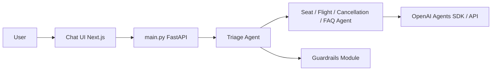

# openai/openai-cs-agents-demo

> Multi-agent customer service demo with the OpenAI Agents SDK and a Next.js visualization UI.

## The problem
Understanding concretely how routing between agents and guardrails work is hard from the SDK documentation alone.

## What it actually does
Python backend: a triage agent that hands off to specialists (flights, booking, seats, FAQ, refunds).
Relevance and anti-jailbreak guardrails visible on screen when they trigger.
Next.js front end with ChatKit displaying the orchestration; fake flight data.
Three scripted scenarios, including a missed connection with rebooking.

## How it is wired


## Trying it
```bash
export OPENAI_API_KEY=your_api_key
cd python-backend
python -m venv .venv
source .venv/bin/activate
pip install -r requirements.txt
python -m uvicorn main:app --reload --port 8000
cd ui
npm install
npm run dev
```

## Cost and gotchas
OpenAI key at your expense; locked into the OpenAI ecosystem.
In-memory data, no persistence.

## What it is not
Not a deployable customer support product.
Not model-provider agnostic.

## Alternatives
No alternative named in the README.

## For you
Keep an eye on it as teaching material: a good readable example of handoffs and guardrails, not to be mistaken for a production base.
