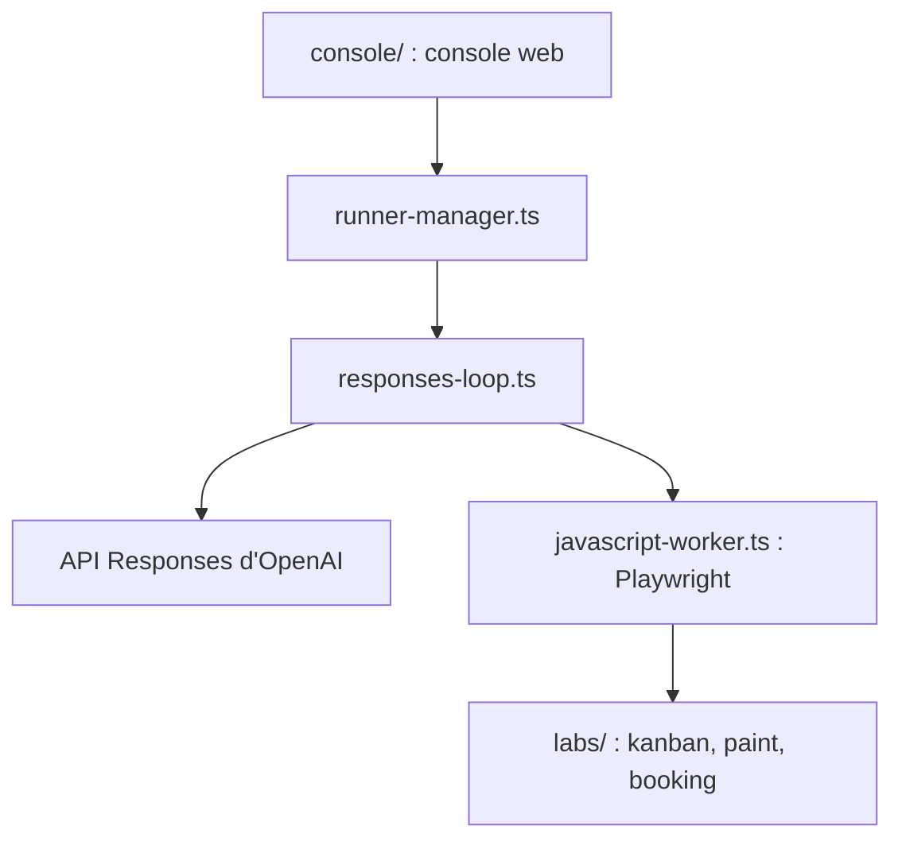

# openai/openai-cua-sample-app

> Two sample agents that drive a browser or a desktop through code, using OpenAI's Responses API.

## The problem
Understanding how to build an agent that inspects an interface, acts, then verifies the result, beyond isolated clicks.

## What it actually does
A JavaScript agent drives a browser with Playwright; a Python agent controls the desktop with PyAutoGUI (screen, mouse, keyboard). Both use the Responses loop, a persistent execution environment and a shared web console with three labs (kanban, paint, booking). Runs can be replayed as JSON with screenshots.

## How it is wired


## Trying it
```bash
corepack enable
pnpm install --frozen-lockfile
cp .env.example .env
export OPENAI_API_KEY="your_api_key_here"
pnpm playwright:install
pnpm dev:js
```

## Cost and gotchas
OpenAI API key and credits consumed on each run; Node 22.20.0 and pnpm 10.26.0. Generated code runs with your privileges, without a sandbox; the Python agent takes over the real mouse and keyboard.

## What it is not
Not a product: an example without OpenAI's production controls. A final answer does not prove the task succeeded. The architecture diagram provided describes an older version of the repository (Python CLI, Docker, Browserbase).

## Alternatives
No alternative named in the README.

## For you
Worth watching: a good example of a tooled agentic loop to read and replay in the labs, but do not run it on your work machine without isolation.
