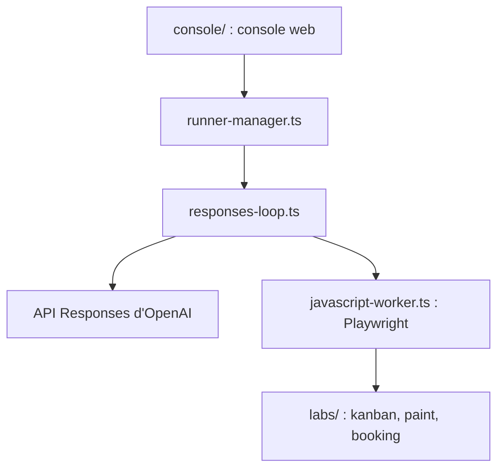

# openai/openai-cua-sample-app

> Deux agents d'exemple qui pilotent un navigateur ou un bureau par code, avec l'API Responses d'OpenAI.

## Le problème
Comprendre comment construire un agent qui inspecte une interface, agit, puis vérifie le résultat, au-delà de simples clics isolés.

## Ce que ça fait vraiment
Un agent JavaScript pilote un navigateur avec Playwright ; un agent Python contrôle le bureau avec PyAutoGUI (écran, souris, clavier). Les deux utilisent la boucle Responses, un environnement d'exécution persistant et une console web commune avec trois laboratoires (kanban, dessin, réservation). Les exécutions sont rejouables en JSON avec captures d'écran.

## Comment c'est branché


## Essayer
```bash
corepack enable
pnpm install --frozen-lockfile
cp .env.example .env
export OPENAI_API_KEY="your_api_key_here"
pnpm playwright:install
pnpm dev:js
```

## Coût et pièges
Clé d'API OpenAI et crédits consommés à chaque exécution ; Node 22.20.0 et pnpm 10.26.0. Le code généré s'exécute avec tes droits, sans bac à sable ; l'agent Python prend la souris et le clavier réels.

## Ce que ce n'est pas
Pas un produit : un exemple sans contrôles de production d'OpenAI. Une réponse finale ne prouve pas la réussite de la tâche. Le diagramme d'architecture fourni décrit une ancienne version du dépôt (CLI Python, Docker, Browserbase).

## Alternatives
Aucune alternative nommée dans le README.

## Pour toi
À surveiller : bon exemple de boucle agentique outillée à lire et à rejouer dans les labs, mais à ne pas lancer sur ta machine de travail sans isolement.

