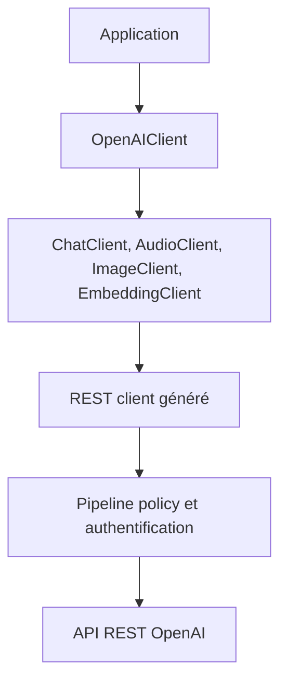

# openai/openai-dotnet

> Official .NET library for calling the OpenAI REST API, generated from its OpenAPI specification.

## The problem
Calling the OpenAI API from .NET by hand means handling authentication, serialization, streaming and retries.

## What it actually does
One client per domain: chat, audio, images, embeddings, responses, assistants, batches, fine-tuning, vector stores, realtime. Each method has an asynchronous variant and streaming is handled. It covers tool calling, structured outputs, audio in chat, file search and web search. A customizable base URL allows OpenAI-compatible APIs. Some APIs remain experimental.

## How it is wired


## Trying it
```bash
dotnet add package OpenAI
```
```csharp
ChatClient client = new(model: "gpt-5.1", apiKey: Environment.GetEnvironmentVariable("OPENAI_API_KEY"));
ChatCompletion completion = client.CompleteChat("Say 'this is a test.'");
```

## Cost and gotchas
An OpenAI API key is required and each call is billed. The README asks you to keep it out of the repository, via an environment variable. `[Experimental]` APIs trigger a compile error that must be explicitly suppressed.

## What it is not
It is not an agent framework: it is an API client. It is not provider-independent, even though the base URL allows compatible APIs.

## Alternatives
No alternative is named in the README.

## For you
Worth watching: keep it in mind only if you call OpenAI from .NET; otherwise this client brings you nothing.
