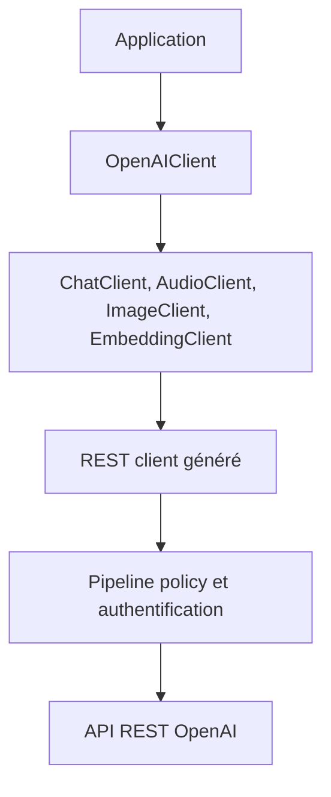

# openai/openai-dotnet

> Bibliothèque .NET officielle pour appeler l'API REST d'OpenAI, générée depuis sa spécification OpenAPI.

## Le problème
Appeler l'API OpenAI depuis .NET à la main demande de gérer authentification, sérialisation, streaming et reprises.

## Ce que ça fait vraiment
Un client par domaine : chat, audio, images, embeddings, réponses, assistants, lots, fine-tuning, vector stores, temps réel. Chaque méthode a une variante asynchrone et le streaming est géré. Il couvre l'appel d'outils, les sorties structurées, l'audio dans le chat, la recherche de fichiers et web. Une URL de base personnalisable permet des API compatibles OpenAI. Certaines API restent expérimentales.

## Comment c'est branché


## Essayer
```bash
dotnet add package OpenAI
```
```csharp
ChatClient client = new(model: "gpt-5.1", apiKey: Environment.GetEnvironmentVariable("OPENAI_API_KEY"));
ChatCompletion completion = client.CompleteChat("Say 'this is a test.'");
```

## Coût et pièges
Une clé d'API OpenAI est requise et chaque appel est facturé. Le README demande de la garder hors du dépôt, via une variable d'environnement. Les API `[Experimental]` provoquent une erreur de compilation à supprimer explicitement.

## Ce que ce n'est pas
Ce n'est pas un framework d'agents : c'est un client d'API. Ce n'est pas indépendant du fournisseur, même si l'URL de base permet des API compatibles.

## Alternatives
Aucune alternative n'est nommée dans le README.

## Pour toi
À surveiller : à retenir seulement si tu appelles OpenAI depuis .NET ; sinon ce client ne t'apporte rien.

