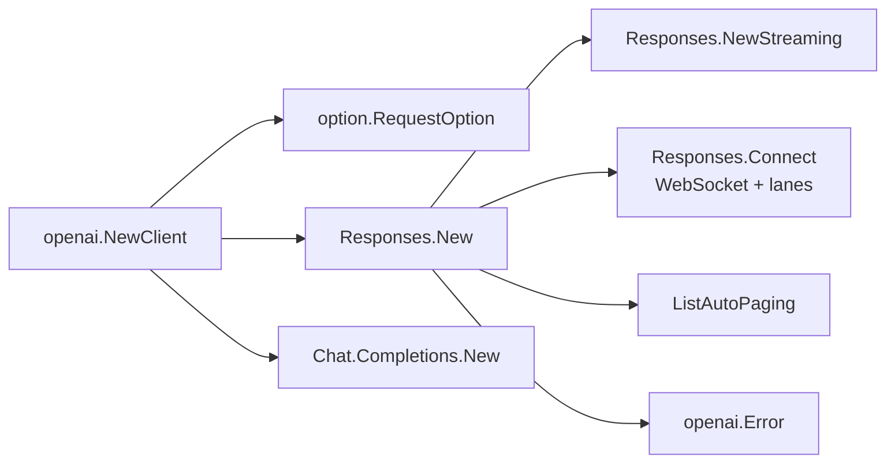

# openai/openai-go

> Official Go SDK for the OpenAI API, for Go developers calling Responses or Chat Completions.

## The problem
Calling the API by hand in Go means rewriting unions, optional fields, pagination and retries.
The "absent field / null field / zero" distinction is laborious in Go without help.

## What it actually does
Primary API is Responses (`client.Responses.New`), plus Chat Completions maintained indefinitely.
Conversations, streaming, tool calling, structured outputs via a generated JSON schema.
`omitzero` semantics: `param.Opt[T]`, `param.Null`, `SetExtraFields`, unions with `OfXxx` fields.
Responses WebSockets: `Connect`, lanes (`StreamID`), `PreviousResponseID`, compaction, `Reconnect`/`Recover`.

## How it is wired


## Trying it
```bash
go get -u 'github.com/openai/openai-go/v3@v3.64.0'
```

## Cost and gotchas
OpenAI bill at your expense; key read from `OPENAI_API_KEY`. SDK >= v3.45.0 requires Go 1.25
(otherwise pin v3.44.0, the last one compatible with Go 1.22–1.24). WebSockets do not work in `js/wasm`.
`Error.DumpRequest`/`DumpResponse` can expose authorization headers.

## What it is not
It is not stable in the strict sense: the README announces "small but real" breaking changes in each version.
It is not a multi-provider client. The service limits (16 active responses, 32 streams,
60-minute connection) are server-side, not handled by the SDK.

## Alternatives
None named apart from the `github.com/invopop/jsonschema` dependency for schemas.

## For you
The default choice if you write a Go service that talks to OpenAI; pin the version.
