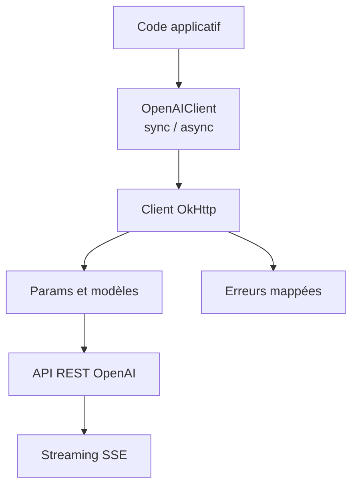

# openai/openai-java

> Official Java SDK for calling the OpenAI REST API, synchronously or asynchronously, intended for Java developers.

## The problem
Calling the OpenAI API from Java by hand means writing the HTTP, serialization, retries and streaming yourself.

## What it actually does
A client with immutable builders for the Responses and Chat Completions APIs, in synchronous mode or with `CompletableFuture`. It handles streaming with accumulators, structured outputs via a JSON schema derived from Java classes, Amazon Bedrock through an optional artifact, and workload identity authentication (Kubernetes, Azure, GCP, X.509 certificate).

## How it is wired


## Trying it
```bash
./scripts/check-env
./scripts/lint
```
Gradle dependency: `implementation("com.openai:openai-java:4.101.0")`. Configuration through `OPENAI_API_KEY`.

## Cost and gotchas
The SDK is free but every call is billed by OpenAI. Java 8 or later is required. One client per application, to share connection pools.

## What it is not
It is not an agent framework nor a multi-provider client: it targets the OpenAI API (and compatible Bedrock). Local schema validation is not remote validation.

## Alternatives
No alternative named in the README.

## For you
Adopt it if you are integrating OpenAI models into a Java service; useless if your work is done in Python.
