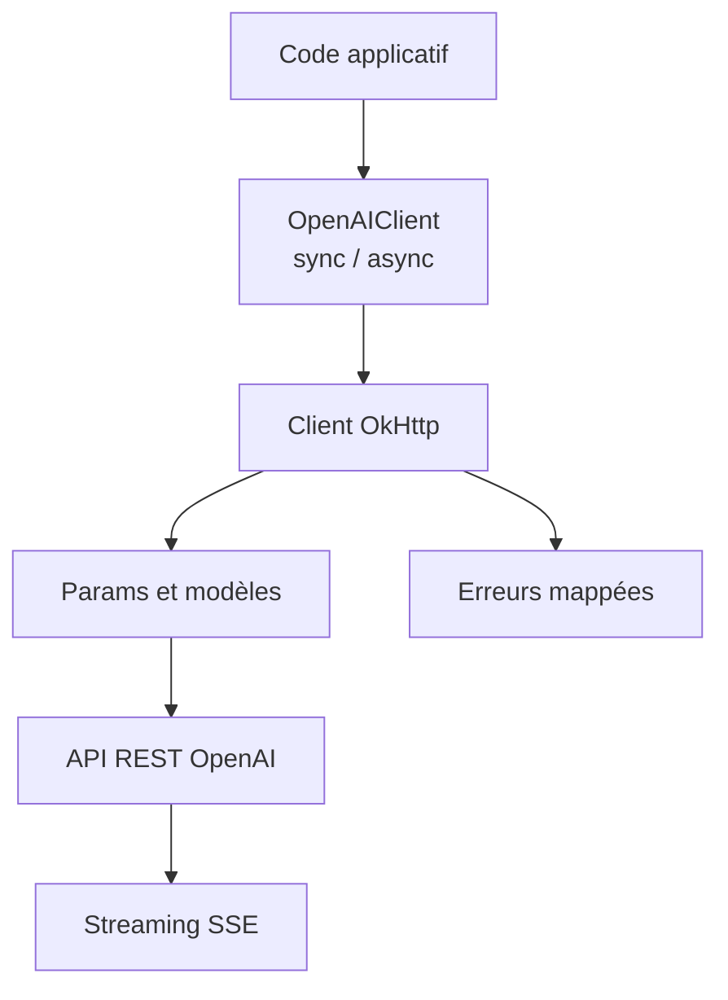

# openai/openai-java

> SDK Java officiel pour appeler l'API REST d'OpenAI, en synchrone ou asynchrone, destiné aux développeurs Java.

## Le problème
Appeler l'API OpenAI depuis Java à la main impose d'écrire le HTTP, la sérialisation, les nouvelles tentatives et le streaming.

## Ce que ça fait vraiment
Un client avec constructeurs immuables pour l'API Responses et Chat Completions, en mode synchrone ou `CompletableFuture`. Il gère le streaming avec accumulateurs, les sorties structurées par schéma JSON dérivé de classes Java, Amazon Bedrock via un artefact optionnel, et l'authentification par identité de charge de travail (Kubernetes, Azure, GCP, certificat X.509).

## Comment c'est branché


## Essayer
```bash
./scripts/check-env
./scripts/lint
```
Dépendance Gradle : `implementation("com.openai:openai-java:4.101.0")`. Configuration par `OPENAI_API_KEY`.

## Coût et pièges
Le SDK est gratuit mais chaque appel est facturé par OpenAI. Il faut Java 8 ou plus. Un seul client par application, pour partager les pools de connexions.

## Ce que ce n'est pas
Ce n'est pas un framework d'agents ni un client multi-fournisseurs : il cible l'API OpenAI (et Bedrock compatible). La validation locale du schéma n'est pas la validation distante.

## Alternatives
Aucune alternative nommée dans le README.

## Pour toi
À adopter si tu intègres des modèles OpenAI dans un service Java ; inutile si ton travail se fait en Python.

