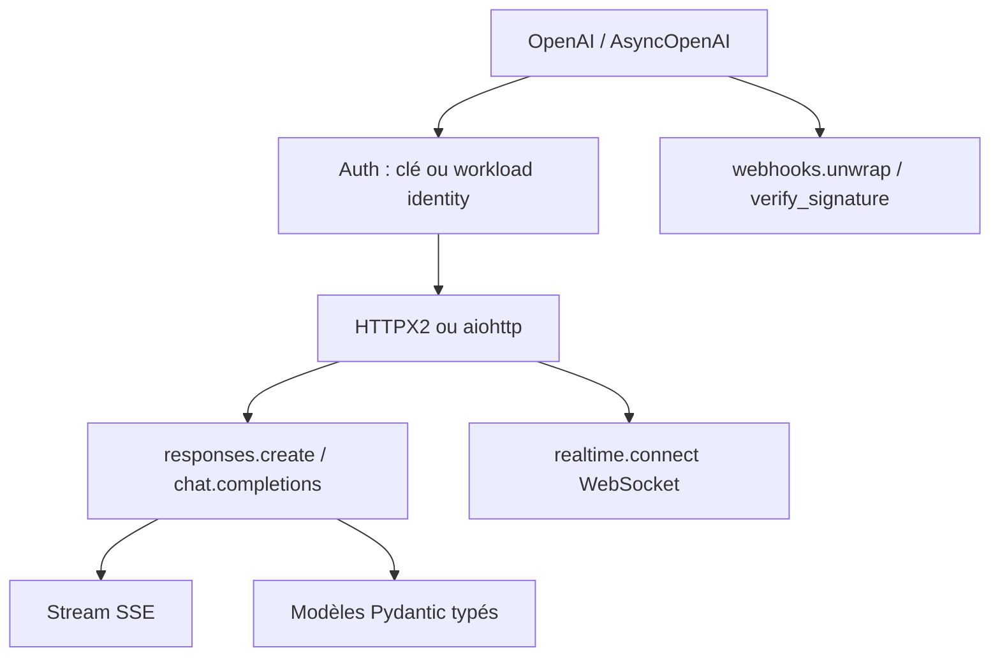

# openai/openai-python

> Official Python client for the OpenAI API, typed, synchronous and asynchronous.

## The problem
Calling an LLM API by hand means handling retries, timeouts, pagination, SSE streaming and webhook verification yourself.
Without types, every response field is a guess.

## What it actually does
Access to the REST API from Python 3.10+, with type definitions for all parameters and response fields, generated from the OpenAPI specification; synchronous and asynchronous clients on HTTPX2.
Main Responses API (`client.responses.create`), Chat Completions API maintained indefinitely, vision by URL or base64, Realtime over WebSocket for text and audio.
Authentication by key, or short-lived-token workload identity: Kubernetes service account tokens, Azure managed identity, GCP metadata, custom provider, and X.509 over mTLS with the `mtls.api.openai.com` endpoint.
Auto-paginated iterators, SSE streaming, file upload, webhook verification and parsing (`client.webhooks.unwrap`), default retries (2) with backoff, default timeout of 10 minutes, `_request_id` on every response.

## How it is wired


## Trying it
```sh
pip install openai
pip install openai[aiohttp]
```

```shell
export OPENAI_LOG=info
```

## Cost and gotchas
The library is free; every call is billed by OpenAI.
The README recommends python-dotenv rather than a hard-coded key; timed-out requests are retried twice by default, which can double a bill on heavy calls.

## What it is not
It is not an agent framework: it is a typed HTTP client.
It is not provider-independent: nothing here abstracts OpenAI.
Consuming a `Stream` is not retried automatically, so as not to duplicate output already delivered: to be handled application-side. The README provided is truncated in the "Accessing raw response data" section.

## Alternatives
No alternative is named in the README.

## For you
Useful as an implementation reference for a clean LLM SDK (retries, request-id, workload identity) even if you do not use it.
