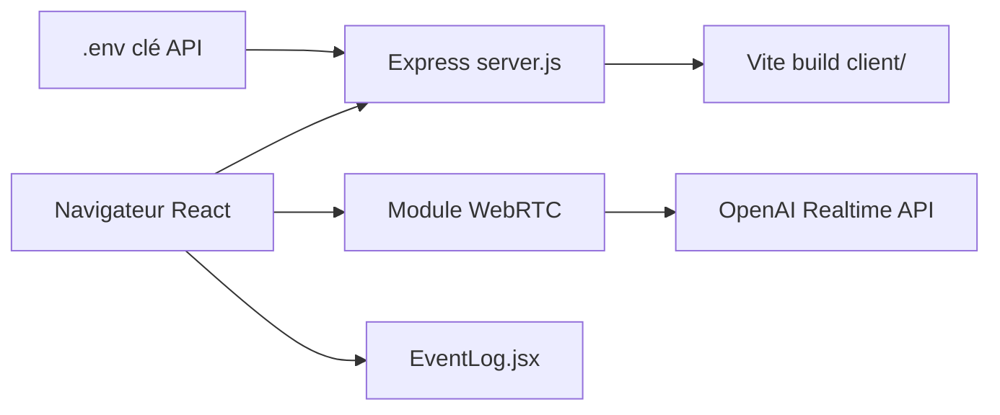

# openai/openai-realtime-console

> Sample application showing OpenAI's Realtime API over WebRTC, for voice developers.

## The problem
Plugging into the Realtime API requires understanding the WebRTC data channel and client/server events.

## What it actually does
An Express server serves a React front end (`client/` folder, built by Vite). The browser opens a WebRTC session to the Realtime API, sends and receives events over the data channel, configures client-side function calls and displays the JSON payloads in a log panel (`EventLog.jsx`).

## How it is wired


## Trying it
```bash
cp .env.example .env
npm install
npm run dev
# http://localhost:3000
```

## Cost and gotchas
OpenAI key in `.env`, pay-per-use billing for the Realtime API. Node.js required. Last push in August 2025.

## What it is not
A minimal template, not a complete application: the README points to another repository (Realtime Agents, Next.js) for a richer example. The old WebSockets version is discouraged for browsers.

## Alternatives
"OpenAI Realtime Agents", a Next.js demo with an agent architecture, named in the README.

## For you
Worth watching as a starting point for a voice prototype on the Realtime API: MIT and short to read, but tied to a paid service and rarely updated.
