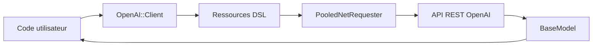

# openai/openai-ruby

> Official typed Ruby library for calling the OpenAI REST API.

## The problem
Calling the OpenAI API from Ruby without writing HTTP requests, pagination, streaming and types yourself.

## What it actually does
Ruby 3.3+ client based on `net/http` with a connection pool. Covers chat, streamed responses, tool runner, files, vector stores, Realtime and WebSockets, with Sorbet, RBS and RBI types. Azure, Bedrock and Vertex providers supported.

## How it is wired


## Trying it
```ruby
gem "openai", "~> 0.120.0"
openai = OpenAI::Client.new(api_key: ENV["OPENAI_API_KEY"])
chat_completion = openai.chat.completions.create(messages: [{role: "user", content: "Say this is a test"}], model: "gpt-5.2")
```

## Cost and gotchas
API key and OpenAI billing are at your expense. Ruby 3.3+ required (Ruby is missing from the list of prerequisites). WebSockets require the `async-websocket` gem. The `0.x` version suggests changes to come.

## What it is not
Not an agent framework: an API client. Hosted assistants remain in beta.

## Alternatives
No alternative named in the README.

## For you
Ignore unless you have a Ruby stack: in the usual Python ecosystem, the official Python SDK already covers this need.
