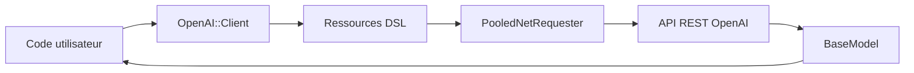

# openai/openai-ruby

> Bibliothèque Ruby officielle, typée, pour appeler l'API REST d'OpenAI.

## Le problème
Appeler l'API OpenAI depuis Ruby sans écrire soi-même requêtes HTTP, pagination, flux et types.

## Ce que ça fait vraiment
Client Ruby 3.3+ basé sur `net/http` avec pool de connexions. Couvre chat, réponses en flux, exécuteur d'outils, fichiers, magasins vectoriels, Realtime et WebSockets, avec types Sorbet, RBS et RBI. Fournisseurs Azure, Bedrock et Vertex pris en charge.

## Comment c'est branché


## Essayer
```ruby
gem "openai", "~> 0.120.0"
openai = OpenAI::Client.new(api_key: ENV["OPENAI_API_KEY"])
chat_completion = openai.chat.completions.create(messages: [{role: "user", content: "Say this is a test"}], model: "gpt-5.2")
```

## Coût et pièges
Clé d'API et facturation OpenAI à ta charge. Ruby 3.3+ requis (Ruby absent de la liste des prérequis). Les WebSockets demandent la gem `async-websocket`. La version `0.x` laisse prévoir des changements.

## Ce que ce n'est pas
Pas un framework d'agents : un client d'API. Les assistants hébergés restent en bêta.

## Alternatives
Aucune alternative nommée dans le README.

## Pour toi
À ignorer sauf pile Ruby : dans l'écosystème Python habituel, le SDK officiel Python couvre déjà ce besoin.

