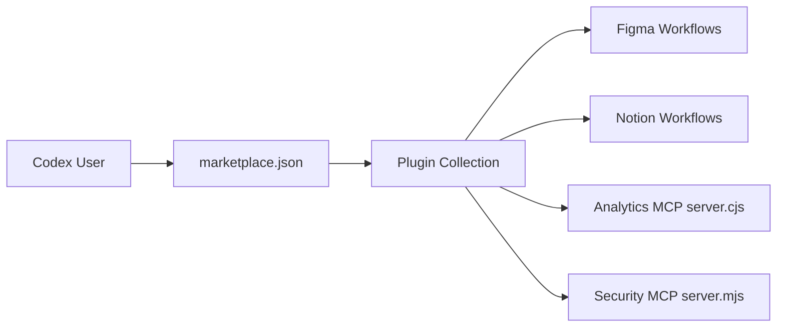

# openai/plugins

> Collection of example plugins for Codex (skills, MCP, apps), for Codex users.

## The problem
Writing a Codex plugin without examples of the manifest and surfaces (skills, MCP, hooks) is trial and error.

## What it actually does
Each plugin lives in `plugins/<name>/` with a `.codex-plugin/plugin.json` manifest and optional surfaces.
A default marketplace `.agents/plugins/marketplace.json`, another for API-key connections.
Rich examples: Figma, Notion, iOS/macOS, web apps, Expo, Netlify, Remotion, Google Slides.
Short README: plugin details are not documented here.

## How it is wired

## Trying it
No command documented in the README.

## Cost and gotchas
Requires Codex (OpenAI account); the plugins rely on third-party services (Figma, Notion…).
No license declared: legal status of reusing the code is unclear.

## What it is not
Not an installable library or a documented SDK.
Not compatible with Claude Code as is.

## Alternatives
No alternative named in the README.

## For you
Ignore unless you develop for Codex: no license, thin README, proprietary ecosystem.
