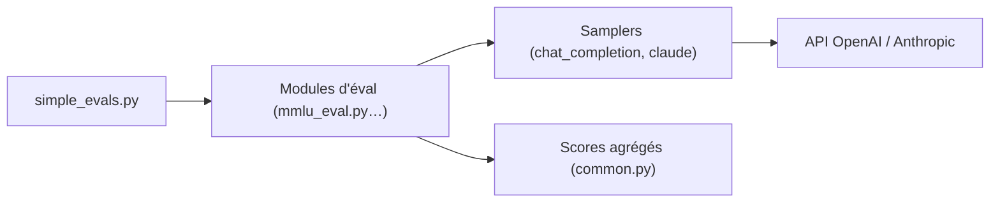

# openai/simple-evals

> Small OpenAI library for evaluating language models zero-shot with chain of thought.

## The problem
Evaluations depend heavily on the prompt (few-shot, role play) and published figures are hard to compare.

## What it actually does
One module per benchmark (MMLU, MATH, GPQA, DROP, MGSM, HumanEval, SimpleQA, BrowseComp, HealthBench) and "samplers" for the OpenAI and Claude APIs. The `simple_evals.py` script lists the models, runs the evaluation and aggregates the scores. The repo also publishes a results table for OpenAI models and other reported models.

## How it is wired


## Trying it
```bash
pip install openai
pip install anthropic
python -m simple-evals.simple_evals --list-models
python -m simple-evals.simple_evals --model <model_name> --examples <num_examples>
```

## Cost and gotchas
Each evaluation consumes paid API calls. There is no unified installation: each eval and each sampler has its own dependencies (HumanEval is cloned separately).

## What it is not
No longer updated for new models since July 2025, PRs and issues are not followed, and no new eval is accepted. It is not a replacement for `openai/evals`. Still maintained as a reference for HealthBench, BrowseComp and SimpleQA.

## Alternatives
- openai/evals: full collection of evaluations.

## For you
Worth watching: serves as a readable reference to reproduce SimpleQA or BrowseComp, but it is frozen, so not a foundation for a lasting evaluation bench.
