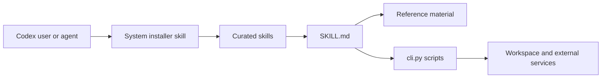

# openai/skills

> Deprecated catalog of skills for Codex, replaced by the OpenAI Plugins repository.

## The problem
Giving Codex reusable capabilities (deployment, CI, design) without rewriting the instructions each time.

## What it actually does
Each skill is a folder with `SKILL.md`, `agents/openai.yaml` metadata, a license and optional scripts.
Three tiers: `.system` (installed by default), `.curated`, `.experimental`.
Installed through the `$skill-installer` skill in Codex, restart required.
Described integrations: GitHub, Cloudflare, Figma, Notion, OpenAI API.

## How it is wired


## Trying it
```bash
$skill-installer gh-address-comments
```

## Cost and gotchas
Free, but tied to Codex; deprecated repository. Licenses at the level of each skill, none at the repository level.

## What it is not
No longer maintained as a reference source: the current examples are in OpenAI Plugins.

## Alternatives
- OpenAI Plugins: the repository that replaces this one.

## For you
Ignore: deprecated and Codex-centric; at best a source of inspiration for writing your own Claude skills.
