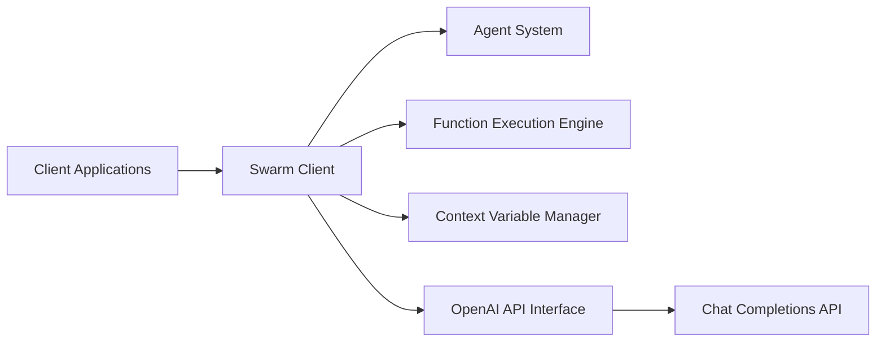

# openai/swarm

> Educational multi-agent orchestration library based on handoffs, replaced by the OpenAI Agents SDK.

## The problem
Coding several agents that hand a conversation off to one another quickly leads to ad hoc loops that are hard to test.

## What it actually does
Two primitives: `Agent` (instructions + functions) and handoff (a function that returns another agent).
`client.run()` loops: completion, tool execution, agent switch, `context_variables` update, stop when there is no new call.
Stateless between calls, based on Chat Completions; automatic conversion of functions to JSON Schema, streaming, demo REPL.
Examples: triage, customer support, airline.

## How it is wired


## Trying it
```bash
pip install git+https://github.com/openai/swarm.git
```

## Cost and gotchas
Every turn consumes your OpenAI key. Installation from Git only, Python 3.10+.

## What it is not
Not meant for production: the README explicitly points to the Agents SDK. Unrelated to the Assistants API despite the name. No persisted memory.

## Alternatives
- OpenAI Agents SDK: maintained successor, recommended for any production use.
- Assistants API: if you want hosted threads, memory and retrieval.

## For you
Ignore it for building, read it to understand: the code is short and shows the handoff pattern well, but the project is no longer evolving.
