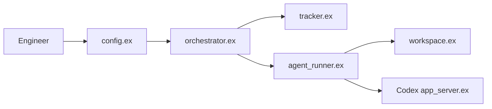

# openai/symphony

> Specification and reference Elixir implementation that turns a ticket board into isolated agent runs.

## The problem
Supervising coding agents one by one does not scale; you would rather steer the work than the agents.

## What it actually does
The repo contains a specification (`SPEC.md`) and an experimental Elixir implementation. According to the code: the orchestrator polls a tracker (Linear, GitHub, GitLab, Jira, Asana), normalizes eligible tickets, creates an isolated workspace and launches a Codex agent. A dashboard and an observability API expose progress. The README talks about proof of work (CI, review, video).

## How it is wired


## Trying it
No command in the repo's README, which points to `elixir/README.md`. It suggests asking an agent:
```text
Implement Symphony according to the following spec:
https://github.com/openai/symphony/blob/main/SPEC.md
```

## Cost and gotchas
Relies on a ticket tracker account and running Codex (API cost on you). The README flags a "low-key" preview, for trusted environments. Works best in codebases already adapted to "harness engineering".

## What it is not
Not a turnkey installable product: it is a spec plus an experimental reference. It does not provide the agent; it launches Codex.

## Alternatives
No alternative named in the README.

## For you
Keep an eye on it: useful as a design reference for orchestrating agents on tickets; too early for adoption (preview, zero issues, dependency on Codex).
