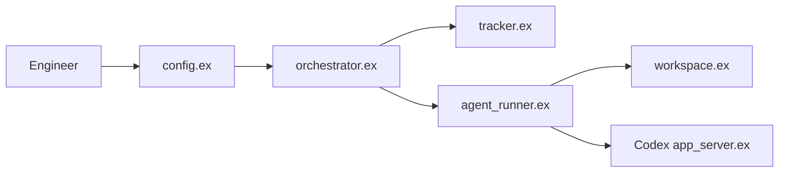

# openai/symphony

> Spécification et implémentation Elixir de référence qui transforme un tableau de tickets en exécutions d'agents isolées.

## Le problème
Superviser des agents de code un par un ne passe pas à l'échelle ; on voudrait piloter le travail, pas les agents.

## Ce que ça fait vraiment
Le dépôt contient une spécification (`SPEC.md`) et une implémentation Elixir expérimentale. D'après le code : l'orchestrateur interroge un tracker (Linear, GitHub, GitLab, Jira, Asana), normalise les tickets éligibles, crée un espace de travail isolé et lance un agent Codex. Un tableau de bord et une API d'observabilité exposent l'avancement. Le README parle de preuves de travail (CI, relecture, vidéo).

## Comment c'est branché


## Essayer
Aucune commande dans le README du dépôt, qui renvoie à `elixir/README.md`. Il propose de demander à un agent :
```text
Implement Symphony according to the following spec:
https://github.com/openai/symphony/blob/main/SPEC.md
```

## Coût et pièges
Compte sur un tracker de tickets et exécution de Codex (coût API à ta charge). README signalant un aperçu « low-key », pour environnements de confiance. Fonctionne mieux dans des bases de code déjà adaptées au « harness engineering ».

## Ce que ce n'est pas
Pas un produit installable clé en main : c'est une spec plus une référence expérimentale. Ne fournit pas l'agent ; il lance Codex.

## Alternatives
Aucune alternative nommée dans le README.

## Pour toi
À surveiller : utile comme référence de conception d'orchestration d'agents sur des tickets ; trop tôt pour une adoption (aperçu, issues à zéro, dépendance à Codex).

