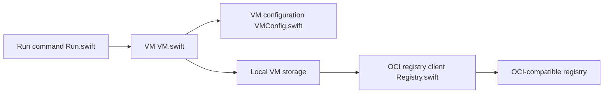

# openai/tart

> Virtualization tool for creating and running macOS and Linux VMs on Apple Silicon, aimed at CI.

## The problem
CI systems need disposable, reproducible macOS VMs with near-native performance.

## What it actually does
Relies on Apple's `Virtualization.Framework` to launch macOS or Linux VMs. Pushes and pulls images to any OCI registry, integrates with a Packer plugin and exposes networking, VNC and local storage management.

## How it is wired


## Trying it
```bash
brew install openai/tools/tart
tart clone ghcr.io/cirruslabs/macos-tahoe-base:latest tahoe-base
tart run tahoe-base
```

## Cost and gotchas
Apple Silicon and macOS 13+ required; 25 GB base image. The license is present but not identified by GitHub: read it before use.

## What it is not
Not an x86 hypervisor nor a Linux-only tool: it requires Apple hardware.

## Alternatives
No alternative named in the README.

## For you
Ignore unless you manage CI runners on Mac; of no interest for a typical data/AI workflow.
