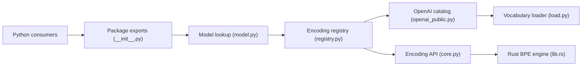

# openai/tiktoken

> BPE tokenizer in Rust with a Python API, used by OpenAI models.

## The problem
Counting or splitting tokens exactly as the target model does is necessary to budget costs and context, and pure-Python tokenizers are slow.

## What it actually does
`get_encoding("o200k_base")` or `encoding_for_model("gpt-4o")` returns an `Encoding` that encodes and decodes reversibly.
The BPE core is in Rust, exposed through bindings; the README claims 3 to 6 times faster than a comparable tokenizer (author's measurement).
Registry extensible through `tiktoken_ext` plugins; vocabularies are loaded and cached by `load.py`.
`_educational` module to train and visualize a simple BPE.

## How it is wired


## Trying it
```bash
pip install tiktoken
```

## Cost and gotchas
Free. The first call downloads the vocabularies: plan for the cache in offline environments.

## What it is not
Not a universal tokenizer: it covers OpenAI encodings, not those of Llama or Qwen. Not a tool for training a tokenizer in production.

## Alternatives
No named alternative; the benchmark cites `GPT2TokenizerFast` from tokenizers/transformers as a point of comparison.

## For you
Adopt: essential for estimating costs and context length before calling an API, and for splitting documents into RAG chunks.
