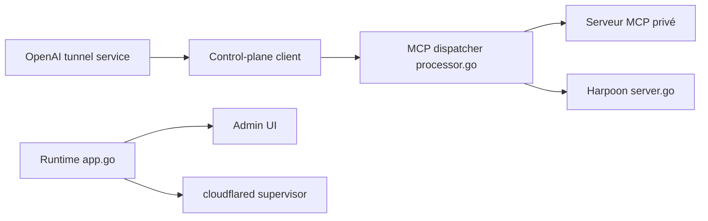

# openai/tunnel-client

> Go agent that connects a private or local MCP server to ChatGPT, Codex and the Responses API.

## The problem
Exposing an internal MCP server to an OpenAI product would require an inbound firewall rule or a public endpoint.

## What it actually does
Long-polls the OpenAI tunnel control plane over HTTPS, relays JSON-RPC requests to your MCP server (HTTP, stdio or in-memory) and returns the responses. Provides an admin UI, `/healthz`, `/readyz`, `/metrics`, OAuth discovery, a "Harpoon" server for allowlisted HTTP calls and an embedded cloudflared.

## How it is wired


## Trying it
```bash
brew install openai/tools/tunnel-client
tunnel-client help quickstart
tunnel-client doctor --profile local-stdio --explain
tunnel-client run --profile local-stdio
```

## Cost and gotchas
Requires a tunnel and a runtime API key on the OpenAI platform, with Tunnels permissions. Only one instance per tunnel in stdio mode.

## What it is not
Not a generic tunnel: unusable without the service hosted by OpenAI. Downloaded ZIPs are not notarized on macOS.

## Alternatives
No alternative cited in the README (cloudflared is embedded).

## For you
Worth watching: useful only if you connect a private MCP to ChatGPT or Codex; otherwise the OpenAI lock-in brings nothing.
