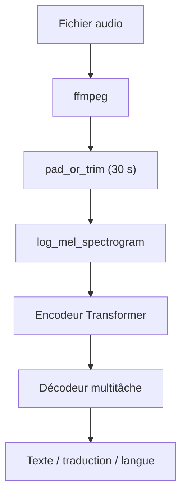

# openai/whisper

> Multilingual speech recognition model, with transcription, translation, and language detection capabilities.

## The problem
Transcription of audio typically involves detecting speech, segmenting it, and then decoding it.
Transcription APIs charge per minute and send the audio to a third-party service.

## What it actually does
A single encoder-decoder Transformer model covers multilingual transcription, translation, and language identification.

Available in six sizes, from `tiny` (39 M, ~1 GB of VRAM) to `large` (1550 M, ~10 GB), plus a `turbo` version (809 M, ~8 times faster).
The `transcribe()` function reads the entire file and processes it using a 30-second sliding window.
A low-level API is available: `load_audio`, `log_mel_spectrogram`, `detect_language`, `decode`.

## How it is wired


## Trying it
```bash
pip install -U openai-whisper
whisper audio.flac audio.mp3 audio.wav --model turbo
whisper japanese.wav --model medium --language Japanese --task translate
whisper --help
```

## Cost and gotchas
Free to use, everything runs locally. `ffmpeg` is required; `rust` may be required if `tiktoken` doesn't have a pre-built package.

Without a GPU, `large` is very slow; the required VRAM ranges from 1 to 10 GB depending on the size.

## What it is not
This is not a diarization system; it does not separate speakers.
`turbo` does not know how to translate – it outputs the original language even with the `--task translate` option.
The quality varies greatly depending on the language; the README refers to the WER (Word Error Rate) per language as reported in the original paper.

## Alternatives
- `ollama/ollama`: While not directly related, the concept of running models locally is logically consistent.

## For you
This is the recommended approach for transcribing locally without sending the audio to another location. It should be adopted.
