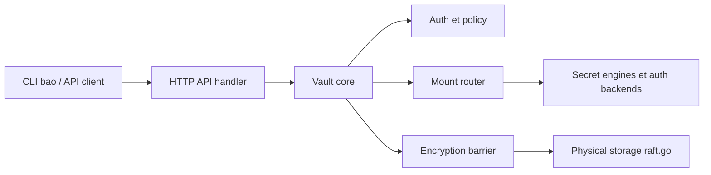

# openbao/openbao

> Go server for managing secrets, certificates and keys, a community fork for infra and security teams.

## The problem
Database credentials, API keys and certificates end up scattered, with no rotation or centralized audit of who accesses what.

## What it actually does
Encrypted key/value secret storage (disk, PostgreSQL, built-in Raft, PebbleDB), generation of dynamic secrets (AWS, SQL databases) with lease and automatic revocation, on-demand encryption (transit engine), access auditing. Authentication backends (AppRole, JWT/OIDC, Kubernetes) and engines are mounted dynamically; plugins run out of process over gRPC.

## How it is wired


## Trying it
```bash
mkdir -p bin
go build -o bin/bao .
go run . server -dev
go test ./some/package
```

## Cost and gotchas
Go compilation from source (the README documents no binary installation). `-dev` mode is a development mode. Importing `github.com/openbao/openbao` as a dependency is not supported.

## What it is not
Not a simple password vault: it is a server to operate (sealing, high availability, audit). Only the `api/v2` and `sdk/v2` libraries are published for import.

## Alternatives
No alternative named in the README (it cites only the OSI license as its reason for existing).

## For you
Keep an eye on it: useful as soon as your ML/MLOps pipelines handle API keys and database credentials that must be rotated, but it is an infra service to operate, not a tool to try in an afternoon.
