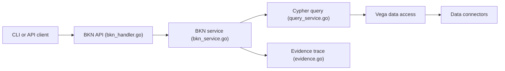

# openbkn-ai/bkn-foundry

> Backend foundation of an ontology-based business knowledge network, to give agents reliable context.

## The problem
Agents connected to proprietary data suffer from context explosion, hallucinations and uncontrolled actions.

## What it actually does
A backend with no web interface: BKN engine (objects, relations, risks, actions, BKN language in Markdown), context loader (recall then ranking), VEGA data virtualization, MCP tool execution factory, access control and evidence tracing. The code shows the BKN and metrics APIs, the Cypher query and access via Vega; the rest is described by the README.

## How it is wired


## Trying it
```bash
git clone https://github.com/openbkn-ai/bkn-foundry.git
cd bkn-foundry/deploy
sudo bash ./preflight.sh
./deploy.sh openbkn install
sudo bash ./onboard.sh
npm install -g @openbkn/bkn-sdk
```

## Cost and gotchas
Targets Linux with Kubernetes, kubectl, helm and containerd; the `onboard.sh` script registers an LLM and an embedding model, so keys are at your expense. The default password of the `test` user is 111111; 191 open issues.

## What it is not
Not a turnkey application: no web console in this repository (BKN Studio is elsewhere). The benchmarks (99.31% accuracy, comparison with Dify and RAGFlow) are published by the authors and not reproduced here.

## Alternatives
- Dify, RAGFlow, BiSheng: platforms compared in the README, simpler to deploy.

## For you
Worth watching for agent governance (tracing, access control), but heavy deployment, license to verify and non-independent results.
