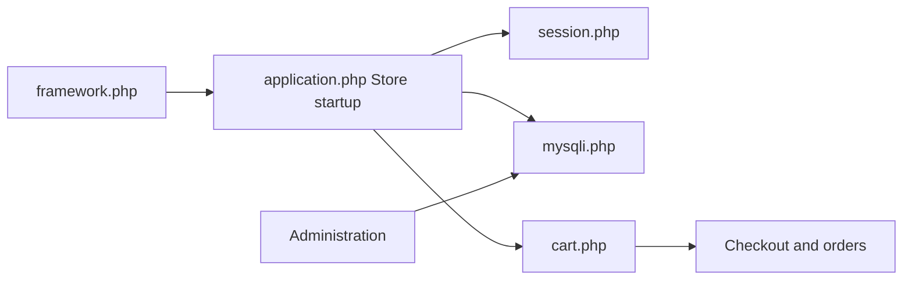

# opencart/opencart

> Free PHP e-commerce platform, for merchants and shop developers.

## The problem
Opening an online shop without developing the catalog, cart and orders yourself.

## What it actually does
PHP shop with storefront, cart, checkout flow, catalog administration, reviews, image manager, localization, extensions and scheduled tasks. The repo provides a Docker development environment (Apache, PHP 8.4 by default, MariaDB) with Adminer, Redis, Memcached or PostgreSQL as options.

## How it is wired


## Trying it
```bash
make init
make build
make up
make down
```
The shop is then available at `http://localhost`.

## Cost and gotchas
Free. On Windows, WSL 2 is strongly recommended, otherwise performance is very poor. A license is present but not identified by GitHub.

## What it is not
Not a turnkey support solution: bugs in third-party extensions are closed without follow-up, according to the README.

## Alternatives
- No alternative named in the README.

## For you
Ignore: PHP e-commerce, unrelated to data/AI; license to be checked.
